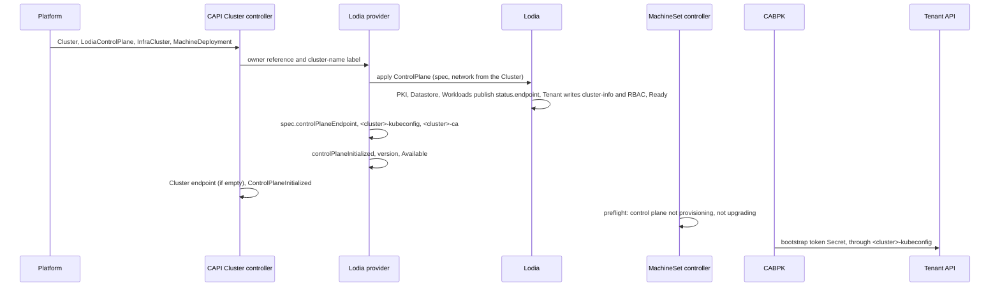

# cluster-api-provider-lodia docs

The [Cluster API](https://cluster-api.sigs.k8s.io/) control plane provider for [Lodia](https://github.com/lodia-io/lodia), which runs Kubernetes control planes as pods on a management cluster, one `ControlPlane` object per tenant cluster.
A `LodiaControlPlane` (`controlplane.lodia.io/v1alpha1`) owns exactly one Lodia `ControlPlane`, named after the `Cluster` and in its namespace.
The provider passes the `LodiaControlPlane`'s spec through to it, takes the network from `Cluster.spec.clusterNetwork`, and reports Lodia's status back in the form Cluster API's [control plane contract][contract] v1beta2 reads.
It creates no Machines and never writes to the `Cluster` or the InfraCluster.
Workers join through Cluster API's kubeadm bootstrap provider (CABPK) with the bootstrap objects that Lodia's Tenant controller writes ([nodes-join-with-kubeadm][lo-kubeadm]): [the e2e suite](../test/e2e/README.md) joins a Docker machine to a cluster of this provider, and runs a pod on it.
`LodiaControlPlaneTemplate` holds the same spec, but the version, `controlPlaneEndpoint` and `restoreFrom`, for ClusterClasses.

Go, controller-runtime; the manager runs as a Deployment of one replica (`cluster-api-provider-lodia-system`, leader election) on a management cluster that runs Lodia and Cluster API.
Pinned sources: Cluster API [v1.15.0-beta.0] (a3b7b6f); kubeadm and Kubernetes v1.35.0; and Lodia's API module at [lodia-io/lodia@5737583][lo].
Links marked 5f212ed point at that older commit of Lodia.

## What it owns

| owns | meaning |
|---|---|
| `LodiaControlPlane`, `LodiaControlPlaneTemplate` | the Cluster API control plane of a `Cluster`, and the template that a ClusterClass takes it from ([the objects](#the-objects)) |
| Lodia's `ControlPlane` of the `Cluster` | one, named after the `Cluster` and in its namespace, built from the spec and the `Cluster`'s network and deleted with its owner |
| `<cluster>-kubeconfig` and `<cluster>-ca` | the copies of Lodia's admin kubeconfig and cluster CA that Cluster API reads |
| the finalizer `controlplane.lodia.io/lodiacontrolplane` and two annotations | `clusterctl.cluster.x-k8s.io/block-move` and `controlplane.lodia.io/uid`, on the `LodiaControlPlane` |
| the contract's endpoint and status | `spec.controlPlaneEndpoint`, and the initialization, versions, `Available` and `Ready` of the `LodiaControlPlane`, from Lodia's; `Paused` is Cluster API's pause |

And deliberately not: Machines, which the MachineSet controller creates; the `Cluster` and the InfraCluster, which the provider never writes; Lodia's own pause, which stays a break-glass switch on the `ControlPlane`.

## The contract, as built

Contract v1beta2 ([rules][cp-rules]).
✓ = built; — = not applicable, left out or not built yet.

| | rule | the provider | source |
|---|---|---|---|
| ✓ | namespaced CRDs with `TypeMeta`/`ObjectMeta`; `LodiaControlPlane` and `LodiaControlPlaneList`; CRD name `lodiacontrolplanes.controlplane.lodia.io` | as stated | [scope][cp-scope], [definition][cp-crd], [CalculateCRDName][crd-name] |
| ✓ | contract label `cluster.x-k8s.io/v1beta2: v1alpha1` on both CRDs; without it CAPI cannot resolve the contract | a `+kubebuilder:metadata:labels` marker; a test checks both CRDs | [label][cp-label], [version.go][ct-label] |
| ✓ | a group other than `controlplane.cluster.x-k8s.io` grants CAPI core full access by an aggregated ClusterRole | `config/rbac/aggregated_role.yaml`, labelled `cluster.x-k8s.io/aggregate-to-manager: "true"` | [group][cp-group], [aggregated_role.yaml][rbac-agg] |
| ✓ | `spec.controlPlaneEndpoint`; the Cluster takes it together with initialization, and only while its own endpoint is empty | from `status.endpoint.apiServer`; never waits for the Cluster's endpoint | [endpoint][cp-endpoint], [cluster_controller_phases.go][cl-cp-endpoint] |
| ✓ | `spec.version`; the version in `status.versions` (preferred) or `status.version` (read when `versions` is absent, dropped by the next contract version) | both, from `status.kubernetes.version`; `versions` holds that one entry | [version][cp-version], [CurrentStatusVersion][ct-current] |
| ✓ | `status.initialization.controlPlaneInitialized` | set once, never cleared ([decision](decisions/status-mirrors-lodia.md)) | [initialization][cp-init] |
| ✓ | `status.externalManagedControlPlane`, written for managed control planes with Machines | always `true` ([why](decisions/one-lodia-controlplane-per-cluster.md#why)) | [rule][cp-extmanaged] |
| ✓ | conditions: `Available` is mirrored into the Cluster's `ControlPlaneAvailable` and must hold through disruption | `Available` mirrors Lodia's `Reachable`; `Ready` and `Paused` beside it ([conditions](#lodiacontrolplane)) | [conditions][cp-conditions], [mirror][cs-available] |
| ✓ | no terminal failure fields | none | [terminal failures][cp-failures] |
| ✓ | `LodiaControlPlaneTemplate` and its list, for ClusterClass | [the objects](#lodiacontrolplanetemplate) | [template][cp-template] |
| ✓ | `<cluster>-kubeconfig` in the Cluster's namespace, type `cluster.x-k8s.io/secret`, label `cluster.x-k8s.io/cluster-name`, key `value`, short-lived client certificate renewed | Lodia's admin kubeconfig, copied | [kubeconfig][cp-kubeconfig], [consts.go][sec-consts] |
| ✓ | cluster certificates as `<cluster>-<purpose>` Secrets with the same type and label; CABPK reads `<cluster>-ca` for a worker's join | `<cluster>-ca` with `tls.crt` only ([why](decisions/the-ca-secret-holds-no-key.md)) | [certificates][cp-certs], [CABPK join][cabpk-worker] |
| ✓ | pause on `Cluster.spec.paused` or `cluster.x-k8s.io/paused`, surfaced as `Paused` | CAPI's `paused.EnsurePausedCondition`; Lodia keeps running | [pausing][cp-pause], [IsPaused][paused] |
| ✓ | clusterctl: `metadata.yaml` | `releaseSeries: [{major: 0, minor: 1, contract: v1beta2}]`, append-only and checked against the CRDs' contract label by `make metadata` | [metadata][cc-metadata] |
| ✓ | clusterctl: `control-plane-components.yaml` | `config/default` rendered by `make release-components`, with the manager's image named `<repository>:<tag>@sha256:<digest>`; a release asset | [components][cc-components] |
| ✓ | the manager's `--namespace` flag, a MUST for clusterctl, and `--watch-filter`, a MUST for several instances of a provider | both ([the manager](#the-manager)) | [components][cc-components], [multiple instances][cp-multi] |
| — | `clusterctl move`: moving deletes the source objects | blocked, and a copy of a `LodiaControlPlane` refused ([decision](decisions/hosted-control-planes-do-not-move.md)) | [move][cc-move], [block-move][move-ann] |
| — | `spec.replicas`, scale subresource, `status.selector` and the four counters ("mandatory if control plane has a notion of number of instances") | left out ([decision](decisions/status-mirrors-lodia.md)); a topology or its ClusterClass must not set `replicas`, `rollout.after`, the machine template's `readinessGates` and `taints`, or the deletion timeouts, and a ClusterClass must not set `machineInfrastructure`: the topology controller then writes them, `machineInfrastructure` as `machineTemplate.spec.infrastructureRef` and `machineTemplate.metadata`, and the CRD declares none of them | [replicas][cp-replicas], [topology][topo-cp], [machine infrastructure][topo-cp-infra] |
| — | `machineTemplate`, rollout after, in-place updates, machine placement, metadata propagation, `minReadySeconds` | no Machines | [machines][cp-machines] |

No admission webhooks: [no-admission-webhooks](decisions/no-admission-webhooks.md).

## The objects

### LodiaControlPlane

Validation is CEL in the CRD ([no-admission-webhooks](decisions/no-admission-webhooks.md)).

| `spec` field | → Lodia `ControlPlane` | rule |
|---|---|---|
| `version` | `spec.version` | required; Lodia's pattern `^v1\.(0\|[1-9][0-9]*)\.(0\|[1-9][0-9]*)$` and minor-never-decreases rule ([types][lo-version]); the topology controller writes it from `Cluster.spec.topology.version`, which CAPI only requires to start with `v` and be semver ([webhook][wh-topology-version]), so a pre-release or build suffix is refused here |
| `controlPlaneEndpoint` | ← `status.endpoint.apiServer.{host,port}` | written by the provider alone; the topology controller leaves it alone while empty ([IgnorePaths][ct-ignore]) |
| `layout`, `highAvailability`, `datastore`, `endpoint`, `apiServer`, `controllerManager`, `scheduler`, `addons`, `placement`, `maintenance`, `health`, `serviceAccount`, `restoreFrom` | same field | Lodia's types and rules |
| — | `network.serviceCIDRs` ← `Cluster.spec.clusterNetwork.services.cidrBlocks` | optional on the Cluster ([ClusterNetwork][api-network]); Lodia requires one or two and never changes them ([types][lo-network]), so a Cluster without them, or a change to them, is refused by Lodia's API server and reported as `Refused` |
| — | `network.podCIDRs` ← `…pods.cidrBlocks` | the same |
| — | `network.clusterDomain` ← `…serviceDomain` | Lodia's default `cluster.local` when unset |
| — | `paused` | never written ([decision](decisions/one-lodia-controlplane-per-cluster.md)) |
| (`Cluster.spec.clusterNetwork.apiServerPort`) | — | ignored: the port is the endpoint mode's ([api-exposure][lo-exposure]) |

| `status` field | from Lodia | note |
|---|---|---|
| `initialization.controlPlaneInitialized` | `Ready` True, at any generation, on a pass that has copied both Secrets | set once, never cleared |
| `externalManagedControlPlane` | — | always `true` |
| `versions`, `version` | `status.kubernetes.version` | set once Lodia reports one ([a version in status](#a-version-in-status)); `versions` holds that one entry |

| condition | written as |
|---|---|
| `Available` | a mirror of Lodia's `Reachable` at any generation: status, reason, message; `Unknown`, `NotYetReported` while the `ControlPlane` has none; `False`, `ControlPlaneNotFound` when an initialized `ControlPlane` is gone, `False`, `Deleting` while the provider waits for the `ControlPlane` to go, unless paused, and `False`, `CopyOfAnotherObject` for a copy of another object ([decision](decisions/hosted-control-planes-do-not-move.md)) |
| `Ready` | a mirror of Lodia's `Ready` at the `ControlPlane`'s current generation, otherwise `Unknown`, `LatestGenerationNotObserved`, unless the provider cannot write: `Refused` (the API server refuses the `ControlPlane` or a Secret; the message is the server's), `ObjectsControlledElsewhere` (the `ControlPlane`, `<cluster>-kubeconfig` or `<cluster>-ca` exists with another controller, or none, which the message names), `ControlPlaneNotFound` (an initialized `ControlPlane` is gone), `Deleting` (waiting for the `ControlPlane` to go, unless paused), `CopyOfAnotherObject` (the object carries the UID of another in `controlplane.lodia.io/uid`) |
| `Paused` | CAPI's pause |

The mirroring is [status-mirrors-lodia](decisions/status-mirrors-lodia.md); the other objects' reasons are [objects-of-another-controller-are-left-alone](decisions/objects-of-another-controller-are-left-alone.md) and [hosted-control-planes-do-not-move](decisions/hosted-control-planes-do-not-move.md).

### LodiaControlPlaneTemplate

`spec.template.{metadata, spec}`, where `spec` holds the pass-through fields without `version`, `controlPlaneEndpoint` and `restoreFrom`, with the same rules; per-cluster values such as `endpoint.gateway.hostnames` come from ClusterClass variables and patches.

## What the provider writes

| object | name | owner | label | content |
|---|---|---|---|---|
| Lodia `ControlPlane` | the Cluster's | controller reference to the `LodiaControlPlane`, `blockOwnerDeletion` | `cluster.x-k8s.io/cluster-name` | the spec above |
| Secret `<cluster>-kubeconfig` | | the same | the same | `value` = key `kubeconfig` of `<cp>-admin-kubeconfig` ([names.go][lo-names-kubeconfig]) |
| Secret `<cluster>-ca` | | the same | the same | `tls.crt` = key `ca.crt` of `<cp>-ca-bundle` ([names.go][lo-names-ca]); no `tls.key` ([decision](decisions/the-ca-secret-holds-no-key.md)) |
| annotations `clusterctl.cluster.x-k8s.io/block-move` and `controlplane.lodia.io/uid` | on the `LodiaControlPlane` | | | `"true"` and the object's own UID, each written when absent, in one patch before the `ControlPlane` is created ([decision](decisions/hosted-control-planes-do-not-move.md)) |

All three objects are applied server-side as `cluster-api-provider-lodia`, both Secrets with `type: cluster.x-k8s.io/secret` ([common_types.go][api-consts]).
What another controller owns is left alone ([decision](decisions/objects-of-another-controller-are-left-alone.md)).

### The cache and the watches

The cache holds no Secret data.
The provider watches the metadata of Secrets labelled `lodia.io/control-plane` ([labels][lo-labels]), maps `<cp>-admin-kubeconfig` and `<cp>-ca-bundle` to the `LodiaControlPlane` of the Cluster of that name, and reads both, and its own two, from the API server on every pass.
`ControlPlane` and `Cluster` events map the same way, through the Cluster's `controlPlaneRef`, so a leftover `ControlPlane` of another owner wakes the provider when it goes.
The cache resyncs every 10 minutes by default, Cluster API's default ([--sync-period][capi-sync]), which repairs the provider's own Secrets, which no watch covers, and a missed delete event.

### RBAC

RBAC is generated from markers into [`config/rbac/role.yaml`](../config/rbac/role.yaml), except leader election, which has a Role of its own in the manager's namespace ([least-privilege-rbac](decisions/least-privilege-rbac.md)).
[`config/rbac/kubeadm_bootstrap_role.yaml`](../config/rbac/kubeadm_bootstrap_role.yaml) and its binding grant Cluster API's kubeadm bootstrap provider `get` on `lodiacontrolplanes` ([kubeadm-bootstrap-grant](decisions/kubeadm-bootstrap-grant.md)); the binding ships in the components YAML with the two variables that [Variables](#variables) documents.

## A pass

Before its first step, a pass refuses a copy of another object ([decision](decisions/hosted-control-planes-do-not-move.md)).

1. Wait for the owner reference the Cluster controller writes ([ensureOwnerRefAndLabel][cl-ownerref]), as both reference providers do.
2. Add the finalizer `controlplane.lodia.io/lodiacontrolplane` ([EnsureFinalizer][finalizers]); then pause ([EnsurePausedCondition][paused-cond]).
3. Write the annotations `clusterctl.cluster.x-k8s.io/block-move` and `controlplane.lodia.io/uid`, each when absent, in one patch that is locked on the resourceVersion the pass read, and end the pass, so that both are stored before anything exists to move or to copy.
   A patch that does not land fails the pass before anything is applied, and the next pass writes the annotations again.
4. Apply the `ControlPlane`, unless it is gone and the `LodiaControlPlane`, read past the cache, is initialized: then report `ControlPlaneNotFound` and end the pass ([decision](decisions/objects-of-another-controller-are-left-alone.md)).
5. Copy the two Secrets from Lodia's, each when its source exists, holds its key and the `ControlPlane` controls it, so a source without its key leaves the last good copy; then copy the status.
   The `LodiaControlPlane` is patched once, at the end ([patch][patch]).

A refused or blocked write, like any other failed one, makes the pass return its error, and the pass is retried with backoff.
While the `ControlPlane` exists and is the provider's, the pass still copies the Secrets and reports the status, and a failure on one Secret does not stop the other.

Deletion: CAPI deletes workers first, then the control plane object, and waits for it ([deletion order][cl-delete]).
The provider deletes the `ControlPlane` and keeps its finalizer until a read past the cache finds the `ControlPlane` gone, which Lodia's `lodia.io/datastore` finalizer decides once the etcd is released (a paused `ControlPlane` waits for unpause); the Secrets go with their owner.
Once the `Cluster` or the owner reference is gone, nothing is left to wait for: the provider removes its finalizer, and the garbage collector deletes the `ControlPlane` and the copies, which the `LodiaControlPlane` owns.
The `cluster.x-k8s.io/paused` annotation on the `LodiaControlPlane` holds this removal too; with the owner reference gone the `Cluster`'s `spec.paused` cannot be read, so it does not hold it.

## The manager

The manager takes the flags of [Cluster API's kubeadm control plane provider](https://github.com/kubernetes-sigs/cluster-api/blob/v1.15.0-beta.0/controlplane/kubeadm/main.go#L128-L217) that apply to it, under their names and with their defaults, but for the concurrency: `--lodiacontrolplane-concurrency` defaults to 10, where that provider's `--kubeadmcontrolplane-concurrency` defaults to [100](https://github.com/kubernetes-sigs/cluster-api/blob/v1.15.0-beta.0/controlplane/kubeadm/main.go#L160-L161); `--help` lists them ([manager-flags-of-kubeadm-control-plane](decisions/manager-flags-of-kubeadm-control-plane.md)).
It logs through klog: `--v` sets the verbosity, `--logging-format` the format, and, unless `--insecure-diagnostics` is set, `/debug/flags/v` on the diagnostics address changes the level while it runs.
`--namespace` limits the manager to one namespace.
`--watch-filter` limits it to the events of objects that carry the label `cluster.x-k8s.io/watch-filter` with that value, and to the events of Lodia's `ControlPlane` and Secrets whose Cluster carries it.
Put the label, with the same value, on a Cluster and on its `LodiaControlPlane`: the filter is honoured only for such a pair, and a pair that carries another value, or none, is left alone.
A pair that disagrees, with the label on one of its objects only or with a different value on each, is not supported: its `LodiaControlPlane` may be reconciled by any event that reaches it, and nothing says which do.
`--lodiacontrolplane-concurrency` (default 10) sets how many `LodiaControlPlane`s are reconciled at once, and a pass has one minute.
The manifest passes `--leader-elect`, `--diagnostics-address` and `--insecure-diagnostics`; the last two take the clusterctl variables `CAPI_DIAGNOSTICS_ADDRESS` (default `:8443`) and `CAPI_INSECURE_DIAGNOSTICS` (default `false`), which [Cluster API documents for every provider](https://github.com/kubernetes-sigs/cluster-api/blob/v1.15.0-beta.0/docs/book/src/user/guide/providers/observability.md?plain=1#L7-L37).

Several instances of the provider from the released YAML are not supported.
A second install rewrites the subjects of the ClusterRoleBindings it shares with the first, which takes the first instance's grants away ([clusterctl](https://github.com/kubernetes-sigs/cluster-api/blob/v1.15.0-beta.0/cmd/clusterctl/client/repository/components.go#L349-L366)), and the leader election Lease has a fixed name, so every instance needs a manager namespace of its own.
`--namespace` and `--watch-filter` are there because the clusterctl contract asks for them and cluster-api-operator can pass them; Cluster API itself gives several instances [best-effort support only](https://github.com/kubernetes-sigs/cluster-api/blob/v1.15.0-beta.0/docs/book/src/developer/core/support-multiple-instances.md?plain=1#L22-L37).

### Under cluster-api-operator

The operator writes the fields of a provider's `spec.manager` as flags of the manager ([customizer](https://github.com/kubernetes-sigs/cluster-api-operator/blob/v0.30.0/internal/controller/component_customizer.go#L198-L421)).
`--watch-filter` and the `--tls-*` flags have no field of their own and reach the manager only through `spec.manager.additionalArgs` or the Deployment's args.

#### Fields that work

- `controller.groupKindConcurrency`
  Only with the key `LodiaControlPlane`: the operator writes `--<key>-concurrency` in lower case.
- `cacheNamespace`
- `metrics.diagnosticsAddress`
  The container's port `metrics` stays 8443, so a Service or scrape config that names it follows only while the address uses that port.
- `metrics.insecureDiagnostics`
- `profilerAddress`
- `leaderElection.leaderElect`
  The operator's [CRD](https://github.com/kubernetes-sigs/cluster-api-operator/blob/v0.30.0/config/crd/bases/operator.cluster.x-k8s.io_controlplaneproviders.yaml#L3032-L3039) requires every field of `leaderElection`.
  With `leaderElect: true`, leave at least one of `leaderElection.resourceName` and `leaderElection.resourceNamespace` empty, or the operator writes `--leader-election-id` and the manager exits.
- `leaderElection.leaseDuration`
- `leaderElection.renewDeadline`
- `leaderElection.retryPeriod`
- `syncPeriod`
- `verbosity`
  The field's default, `1`, writes no flag and leaves the manager at `--v=2`, as in [Cluster API's kubeadm control plane provider](https://github.com/kubernetes-sigs/cluster-api/blob/v1.15.0-beta.0/controlplane/kubeadm/main.go#L234-L237).
  `additionalArgs` with the key `--v` and the value `1` sets 1.
- `additionalArgs`
  For `--watch-filter` and the three `--tls-*` flags.

#### A field that works only as `:9440`

- `health.healthProbeBindAddress`
  The probes use the container's port `healthz`, 9440, which the operator never changes.
  Any other port, or a loopback host, fails the probes and restarts the pod.

#### Fields that make the manager exit at start

The operator writes a flag the manager does not define.

- `controller.groupKindConcurrency`
  With any other key, such as `LodiaControlPlane.controlplane.lodia.io`, which the field's own documentation asks for.
- `maxConcurrentReconciles`
  Cluster API's kubeadm control plane provider refuses it too.
- `metrics.bindAddress`
  Cluster API's kubeadm control plane provider refuses it too.
- `webhook.host`
  Cluster API's kubeadm control plane provider refuses it too.
- `leaderElection.resourceName`
  With `leaderElection.resourceNamespace` and `leaderElect: true` the operator writes `--leader-election-id`, which Cluster API's kubeadm control plane provider refuses too.
- `webhook.port`
  The provider has no webhooks; Cluster API's kubeadm control plane provider accepts it.
- `webhook.certDir`
  The provider has no webhooks; Cluster API's kubeadm control plane provider accepts it.
- `featureGates`
  The provider has no feature gates; Cluster API's kubeadm control plane provider accepts it.

#### Fields that break the probes

The operator writes no flag, and moves the probes off `/healthz` and `/readyz`, which the manager serves.

- `health.livenessEndpointName`
- `health.readinessEndpointName`

#### Fields the operator ignores

The operator writes no flag for them and changes nothing else ([`gracefulShutDown`](https://github.com/kubernetes-sigs/cluster-api-operator/blob/v0.30.0/internal/controller/component_customizer.go#L234) and [`controller.cacheSyncTimeout`](https://github.com/kubernetes-sigs/cluster-api-operator/blob/v0.30.0/internal/controller/component_customizer.go#L202) are marked TODO there).

- `gracefulShutDown`
- `controller.cacheSyncTimeout`
- `controller.recoverPanic`
- `leaderElection.resourceLock`
- `leaderElection.resourceNamespace`
  With `leaderElection.resourceName` empty; with both set and `leaderElect: true` it makes the manager exit, as listed above.

## The flow



1. Lodia builds the `ControlPlane`: Workloads publishes `status.endpoint`, PKI writes the admin kubeconfig against it ([pki/secrets.go][lo-admin]) and the CA bundle, Tenant writes `cluster-info`, `kubeadm-config`, `kubelet-config` and the RBAC for the group `system:bootstrappers:kubeadm:default-node-token` ([bootstrap.yaml][lo-bootstrap-rbac]), Lifecycle sets `Ready` ([README][lo-readme-lifecycle]).
2. The provider does not wait for `Cluster.spec.controlPlaneEndpoint`: CAPI copies the control plane's endpoint only once the control plane reports initialized, and only while the Cluster's is empty ([cluster_controller_phases.go][cl-cp-endpoint]).
   A Cluster without `infrastructureRef` counts as provisioned ([no infra][cl-noinfra]); with an InfraCluster, that one must leave the endpoint empty.
3. CAPI sets `ControlPlaneInitialized` on the Cluster ([status][cs-init]); its ClusterCache connects with `<cluster>-kubeconfig` once the infrastructure is provisioned, and refuses exec or auth-provider credentials ([cluster_cache.go][cache-infra], [REST config][cache-rest]); Lodia's admin kubeconfig carries client certificates.
4. The MachineSet controller creates Machines only while the control plane is neither provisioning (no reported version) nor upgrading (`spec.version` above it), and, with `KubeadmConfigTemplate`, only for the control plane's minor ([preflight][ms-preflight], [kubeadm skew][ms-kubeadm], gate on by default: [feature.go][feature], [contract state][ct-state]).
5. CABPK waits for `ControlPlaneInitialized` ([gate][cabpk-gate]), reads `<cluster>-ca`, pins every certificate in `tls.crt`, takes `apiServerEndpoint` from the Cluster, and creates a bootstrap token in the tenant through the ClusterCache ([joinWorker][cabpk-worker], [reconcileDiscovery][cabpk-discovery], [token.go][cabpk-token]); kubeadm join reads `cluster-info`, waits for its JWS signature from Lodia's bootstrap signer, checks any CA against the pins and bootstraps against the server `cluster-info` names ([discovery][kubeadm-discovery], [pins][kubeadm-pins], [JWS wait][kubeadm-jws]).

**Upgrade.**
A new `spec.version` within a minor reaches Lodia, and `status.version` moves when Lodia's version does, so CAPI holds new workers as "upgrading" until then and then lets the MachineDeployment follow.
Lodia at the pin moves its target within a minor only ([target][lo-target]): a `spec.version` of another minor leaves the target where it is, `Progressing` `False`, `Unsupported`, so `status.kubernetes.version` stays behind and CAPI holds new workers ([contract state][ct-state]) until Lodia builds minor upgrades.

## What Cluster API needs from Lodia

| Cluster API needs | Lodia | where |
|---|---|---|
| a control plane version in status | `status.kubernetes.version` ([field reference][lo-ref-kubernetes]) | — |
| an `Available` that survives node outages | `Reachable` is about the API; the controller manager hold is `ControllerManagerHeld`, outside `Ready` ([conditions][lo-ref-conditions]) | — |
| `<cluster>-ca` with `tls.crt` | `<cp>-ca-bundle` (`ca.crt`); the key is PKI's alone by design | — |
| names a CAPI `Cluster` can have | a DNS-1035 label of at most 32 characters, CEL ([types][lo-name-cap], [field reference][lo-ref-name]); two Clusters in one namespace can claim one Secret name, as `a-admin-kubeconfig` is Cluster `a-admin`'s kubeconfig and `a`'s `<cp>-admin-kubeconfig` ([names.go][lo-names-kubeconfig]), and whoever comes first keeps the name, and the other reports it | — |
| types a provider can import | `go.lodia.io/lodia/api`, with the CRDs as `crds.FS`, requires `k8s.io/api` and `k8s.io/apimachinery` v0.35.0, below the v0.37 Cluster API v1.15.0-beta.0 builds on ([go.mod][lo-api-gomod]) | — |
| replica counts, only with `spec.replicas` | none | not now ([decision](decisions/status-mirrors-lodia.md)) |
| endpoint, kubeconfig, initialized, network | `status.endpoint.apiServer`, `<cp>-admin-kubeconfig`, `Ready`, `spec.network` | none needed |

### A version in status

With no `status.versions` and no `status.version`, the contract reads the control plane as provisioning; with `spec.version` above the reported one, as upgrading ([contract state][ct-state]).
Either holds every new Machine in the MachineSet preflight `ControlPlaneIsStable`, which runs by default ([preflight][ms-preflight], [feature.go][feature]), and the topology controller uses the same checks for ClusterClass upgrades.
Without a version, no worker is ever created.
Lodia's `status.kubernetes.version` is what the provider copies: the oldest version any part of the control plane runs ([field reference][lo-ref-kubernetes]).

### The CA Secret

CABPK looks up `<cluster>-ca` for a worker as a set holding the cluster CA alone ([NewCertificatesForWorker][sec-worker], [joinWorker][cabpk-worker]) and requires key data only for a certificate that names a key file, which the worker's does not ([EnsureAllExist][sec-ensure]).
The worker path never uses the key: it hashes the certificates in `tls.crt` ([Hashes][sec-hashes], [discovery][cabpk-discovery]).
A test calls `NewCertificatesForWorker`, `Lookup` and `EnsureAllExist` on the Secret the provider writes.

The provider copies `ca.crt` into `tls.crt`; during a rotation both CAs travel, CABPK pins both and kubeadm accepts any ([pins][kubeadm-pins]).
It never copies the key ([decision](decisions/the-ca-secret-holds-no-key.md)).

## Installation

What a release holds, how releases are numbered and that the pre-releases are unsigned: [releases-through-clusterctl](decisions/releases-through-clusterctl.md).
The provider's watches need Lodia's CRDs, so install Lodia before the provider.
A release of the provider is built and tested against [Lodia at 57375832e7fe](https://github.com/lodia-io/lodia/tree/57375832e7fe8b3a06374613797eb4c544fe7612), the `LODIA_COMMIT` of the [`Makefile`](../Makefile) and the pseudo-version of `go.lodia.io/lodia/api` in [`go.mod`](../go.mod).
Lodia has no release yet, so that commit is the requirement of every release.

### The Cluster API version

A release of the provider needs Cluster API v1.15.0-beta.0, for the core provider and for the kubeadm bootstrap provider, until the provider's pin moves to v1.15.0 ([`todo.md`](../todo.md)).
The provider copies Lodia's cluster CA into the Secret `<cluster>-ca` as `tls.crt` and writes no `tls.key`, which a worker's join accepts only with a Cluster API release that has the fix ([why](decisions/the-ca-secret-holds-no-key.md#consequences)).
Without a version, clusterctl and cluster-api-operator install the newest stable release ([clusterctl](https://github.com/kubernetes-sigs/cluster-api/blob/v1.15.0-beta.0/cmd/clusterctl/client/repository/repository_versions.go#L86-L153), [operator](https://github.com/kubernetes-sigs/cluster-api-operator/blob/v0.30.0/internal/controller/manifests_downloader.go#L89-L97)), so every command below names the version.

### With clusterctl

Add the provider to [clusterctl's configuration file](https://github.com/kubernetes-sigs/cluster-api/blob/v1.15.0-beta.0/docs/book/src/reference/clusterctl/configuration.md?plain=1#L3), the way clusterctl [takes a provider outside its built-in list](https://github.com/kubernetes-sigs/cluster-api/blob/v1.15.0-beta.0/docs/book/src/reference/clusterctl/configuration.md?plain=1#L10-L44):

```yaml
providers:
- name: lodia
  url: https://github.com/lodia-io/cluster-api-provider-lodia/releases/latest/control-plane-components.yaml
  type: ControlPlaneProvider
```

Use the name `lodia`: the manifests are labelled `cluster.x-k8s.io/provider: control-plane-lodia`, which is the label clusterctl [sets](https://github.com/kubernetes-sigs/cluster-api/blob/v1.15.0-beta.0/cmd/clusterctl/client/repository/components.go#L543-L564) for that name.
Install Cluster API at [the version the provider needs](#the-cluster-api-version) and the provider with it:

```sh
clusterctl init --core cluster-api:v1.15.0-beta.0 --bootstrap kubeadm:v1.15.0-beta.0 --control-plane lodia --infrastructure <yours>
```

`--control-plane lodia` installs the newest release of the provider, and `--control-plane lodia:v0.1.0-alpha.1` pins a version.
A named control plane provider replaces the kubeadm one that `init` adds on its first run otherwise ([defaults](https://github.com/kubernetes-sigs/cluster-api/blob/v1.15.0-beta.0/cmd/clusterctl/client/init.go#L275-L297)).
While every release is a pre-release, `latest` is the newest one; once a stable release exists, `latest` skips pre-releases ([selection](https://github.com/kubernetes-sigs/cluster-api/blob/v1.15.0-beta.0/cmd/clusterctl/client/repository/repository_versions.go#L86-L153)).

The manifest names its image by digest.
An `images:` entry of clusterctl's configuration for `control-plane-lodia` with a `repository` moves the pull to a mirror and keeps the tag and the digest, so the mirror must hold the same image; a `tag` entry changes the tag and the digest still names the image ([overrides](https://github.com/kubernetes-sigs/cluster-api/blob/v1.15.0-beta.0/docs/book/src/reference/clusterctl/configuration.md?plain=1#L215-L286), [how they apply](https://github.com/kubernetes-sigs/cluster-api/blob/v1.15.0-beta.0/cmd/clusterctl/client/config/imagemeta_client.go#L58-L164), [the reference](https://github.com/kubernetes-sigs/cluster-api/blob/v1.15.0-beta.0/util/container/image.go#L43-L81)).

### Variables

clusterctl reads a variable from the environment, and from its configuration file when the environment lacks it ([variables](https://github.com/kubernetes-sigs/cluster-api/blob/v1.15.0-beta.0/docs/book/src/reference/clusterctl/configuration.md?plain=1#L46-L66)).

| variable | default | meaning |
|---|---|---|
| `LODIA_KUBEADM_BOOTSTRAP_SA_NAMESPACE` | `capi-kubeadm-bootstrap-system` | the namespace of the kubeadm bootstrap provider's ServiceAccount |
| `LODIA_KUBEADM_BOOTSTRAP_SA_NAME` | `capi-kubeadm-bootstrap-manager` | its name |
| `CAPI_DIAGNOSTICS_ADDRESS` | `:8443` | where the manager serves diagnostics, see [The manager](#the-manager) |
| `CAPI_INSECURE_DIAGNOSTICS` | `false` | whether it serves them without TLS and authentication |

The defaults of the first two are the namespace and the name that a clusterctl install of the kubeadm bootstrap provider gives its ServiceAccount ([namespace](https://github.com/kubernetes-sigs/cluster-api/blob/v1.15.0-beta.0/bootstrap/kubeadm/config/default/kustomization.yaml#L1-L4), [name](https://github.com/kubernetes-sigs/cluster-api/blob/v1.15.0-beta.0/bootstrap/kubeadm/config/rbac/service_account.yaml#L1-L5)); set them when yours differ.
The manifest binds that ServiceAccount's user, `system:serviceaccount:<namespace>:<name>` ([form](https://github.com/kubernetes/kubernetes/blob/v1.35.0/staging/src/k8s.io/apiserver/pkg/authentication/serviceaccount/util.go#L53-L57)), to a ClusterRole that grants `get` on `lodiacontrolplanes` and nothing else ([why](decisions/kubeadm-bootstrap-grant.md)).

clusterctl keeps no variable's value in the cluster, and processes the variables again at every `clusterctl upgrade` ([inventory](https://github.com/kubernetes-sigs/cluster-api/blob/v1.15.0-beta.0/cmd/clusterctl/client/repository/components.go#L120-L138), [upgrade](https://github.com/kubernetes-sigs/cluster-api/blob/v1.15.0-beta.0/cmd/clusterctl/client/cluster/upgrader.go#L353-L373)).
A value given to `init` and not to `upgrade` falls back to its default, and the grant then names the default ServiceAccount.
Keep the values in clusterctl's configuration file, as top-level keys, on every machine that upgrades the management cluster.

### With cluster-api-operator

Install Cluster API at [the version the provider needs](#the-cluster-api-version): a `spec.version` on the core provider and on the kubeadm bootstrap provider, since the operator installs the newest stable release without one.

```yaml
apiVersion: operator.cluster.x-k8s.io/v1alpha2
kind: CoreProvider
metadata:
  name: cluster-api
  namespace: capi-system
spec:
  version: v1.15.0-beta.0
---
apiVersion: operator.cluster.x-k8s.io/v1alpha2
kind: BootstrapProvider
metadata:
  name: kubeadm
  namespace: capi-kubeadm-bootstrap-system
spec:
  version: v1.15.0-beta.0
```

Then the provider:

```yaml
apiVersion: operator.cluster.x-k8s.io/v1alpha2
kind: ControlPlaneProvider
metadata:
  name: lodia
  namespace: cluster-api-provider-lodia-system
spec:
  version: v0.1.0-alpha.1
  fetchConfig:
    url: https://github.com/lodia-io/cluster-api-provider-lodia/releases/latest/control-plane-components.yaml
  configSecret:
    name: lodia-variables
```

The operator takes the version from `spec.version` ([FetchConfiguration](https://github.com/kubernetes-sigs/cluster-api-operator/blob/v0.30.0/api/v1alpha2/provider_types.go#L270-L298)).
The `url` has to be in clusterctl's full form, `https://github.com/{owner}/{repo}/releases/{latest|version}/control-plane-components.yaml`.
The `https://github.com/{owner}/{repo}/releases` that the operator's [docs](https://github.com/kubernetes-sigs/cluster-api-operator/blob/v0.30.0/docs/book/src/03_topics/02_configuration/05_provider-spec-configuration.md?plain=1#L15-L24) show is refused by clusterctl's library, both [at v1.14.0](https://github.com/kubernetes-sigs/cluster-api/blob/v1.14.0/cmd/clusterctl/client/repository/repository_github.go#L217-L225), which the operator [builds on](https://github.com/kubernetes-sigs/cluster-api-operator/blob/v0.30.0/go.mod#L28), and [at v1.15.0-beta.0](https://github.com/kubernetes-sigs/cluster-api/blob/v1.15.0-beta.0/cmd/clusterctl/client/repository/repository_github.go#L212-L225).
The operator reads variables only from the Secret that `spec.configSecret` names, in the provider's namespace, and uses them when it creates and upgrades the provider's components ([ConfigSecret](https://github.com/kubernetes-sigs/cluster-api-operator/blob/v0.30.0/api/v1alpha2/provider_types.go#L54-L62), [reader](https://github.com/kubernetes-sigs/cluster-api-operator/blob/v0.30.0/internal/controller/phase_initialize.go#L125-L176)): put the `LODIA_*` variables in it.
[Under cluster-api-operator](#under-cluster-api-operator) says which fields of `spec.manager` the provider takes.

### Without clusterctl

`control-plane-components.yaml` holds clusterctl variables, which `kubectl apply` would leave as text.
Apply the output of `clusterctl generate yaml --from control-plane-components.yaml` instead: it substitutes the variables and does no more, so it sets no namespace, label or image ([generate yaml](https://github.com/kubernetes-sigs/cluster-api/blob/v1.15.0-beta.0/cmd/clusterctl/client/config.go#L75-L111)).

## Upgrade

`clusterctl upgrade plan` never proposes a pre-release ([next version](https://github.com/kubernetes-sigs/cluster-api/blob/v1.15.0-beta.0/cmd/clusterctl/client/cluster/upgrader_info.go#L166-L196)), so between pre-releases name the version: `clusterctl upgrade apply --control-plane lodia:v0.1.0-alpha.2` ([the `provider:version` form](https://github.com/kubernetes-sigs/cluster-api/blob/v1.15.0-beta.0/cmd/clusterctl/client/upgrade.go#L283-L312)).
For the same reason a management cluster that runs an older Cluster API takes [the version the provider needs](#the-cluster-api-version) by name: `clusterctl upgrade apply --core cluster-api:v1.15.0-beta.0 --bootstrap kubeadm:v1.15.0-beta.0` ([flags](https://github.com/kubernetes-sigs/cluster-api/blob/v1.15.0-beta.0/cmd/clusterctl/cmd/upgrade_apply.go#L78-L85)).
With cluster-api-operator, set `spec.version`, of the provider and of Cluster API's core and kubeadm bootstrap providers.
Keep the variables as [above](#variables) for either.
`upgrade plan` reads the repository of every provider of the management cluster, and fails when one has no entry in the configuration of the machine it runs on, so every machine that upgrades the management cluster needs the `providers:` entry ([provider info](https://github.com/kubernetes-sigs/cluster-api/blob/v1.15.0-beta.0/cmd/clusterctl/client/cluster/upgrader_info.go#L51-L123)).

## `clusterctl move`

The provider refuses `clusterctl move` ([hosted-control-planes-do-not-move](decisions/hosted-control-planes-do-not-move.md)).
It writes the annotation `clusterctl.cluster.x-k8s.io/block-move` on every `LodiaControlPlane` before it creates Lodia's `ControlPlane`, in the pass after the finalizer and the `Paused` condition, and never removes it.

What the refusal costs:
- A live move pauses the Clusters and ClusterClasses, waits about six minutes for the annotation and fails ([move](https://github.com/kubernetes-sigs/cluster-api/blob/v1.15.0-beta.0/cmd/clusterctl/client/cluster/mover.go#L337-L419), [wait](https://github.com/kubernetes-sigs/cluster-api/blob/v1.15.0-beta.0/cmd/clusterctl/client/cluster/mover.go#L685-L743)).
- The Clusters stay paused, since clusterctl unpauses only at the end of a successful move ([unpause](https://github.com/kubernetes-sigs/cluster-api/blob/v1.15.0-beta.0/cmd/clusterctl/client/cluster/mover.go#L416-L418)).
  Set `spec.paused` of each Cluster back to `false` and remove the annotation `cluster.x-k8s.io/paused` from each ClusterClass ([pause](https://github.com/kubernetes-sigs/cluster-api/blob/v1.15.0-beta.0/cmd/clusterctl/client/cluster/mover.go#L593-L645)).
- A move takes one namespace and has no filter for a Cluster, so the annotation blocks the move of every Cluster in the namespace ([flags](https://github.com/kubernetes-sigs/cluster-api/blob/v1.15.0-beta.0/cmd/clusterctl/cmd/move.go#L75-L92), [namespace](https://github.com/kubernetes-sigs/cluster-api/blob/v1.15.0-beta.0/cmd/clusterctl/client/move.go#L85-L102)).
- `--dry-run` reports success, since it skips the wait.

Never remove `block-move` by hand to get a move through: [why](decisions/hosted-control-planes-do-not-move.md#why).

The provider also refuses a copy of a `LodiaControlPlane`: it builds no `ControlPlane` and no Secret for it, writes nothing else to it, and sets `Ready` and `Available` to `False` with the reason `CopyOfAnotherObject`.
That covers what `block-move` does not stop: `clusterctl move --to-directory` followed by `--from-directory`, and a restore from a backup of the Cluster API objects.
To give the copy a new, empty control plane, remove its annotation `controlplane.lodia.io/uid`: the provider then builds a new `ControlPlane`, with a new CA and an empty etcd, and writes `<cluster>-kubeconfig` and `<cluster>-ca` anew.

## What breaks, and how it shows

- *The endpoint is copied once* ([Cluster controller][cl-cp-endpoint]): a LoadBalancer Service recreated with a new address, or in node port mode the loss of the node the endpoint names ([field reference][lo-ref-nodeport]), leaves the Cluster, and every later join, on the old address.
- *MachineHealthCheck against the controller manager hold.*
  When nodes are cut off from the control plane, Lodia holds the controller manager so nothing evicts their pods ([README][lo-readme-health]); an MHC sees the same nodes NotReady and replaces the Machines.
  Recommend `remediation.triggerIf.unhealthyLessThanOrEqualTo` below Lodia's hold fraction, 0.6 ([MHC][mhc], [configuration][lo-readme-config]).
- *Hibernation (Lodia's phase 3).*
  The API is down by design: the ClusterCache probe fails, the Cluster reports unavailable, and an MHC replaces every node.
- *The management cluster reaches the tenant through the public endpoint*, the address in `<cluster>-kubeconfig`: gateway mode needs in-cluster DNS and a hairpin through the Gateway, and a NetworkPolicy on the API server has to admit CAPI's controllers from inside the management cluster ([README][lo-readme-netpol]).
- *One credential for two uses.*
  CAPI's kubeconfig "MUST not be shared with other users or applications" ([kubeconfig][cp-kubeconfig]); Lodia's admin kubeconfig is also the platform's automation credential ([short-lived-kubeconfigs][lo-shortlived]), so revoking one revokes both.
- *Stricter skew for CAPI workers.*
  The kubeadm preflight creates workers only on the control plane's minor ([kubeadm skew][ms-kubeadm]), while Lodia lets nodes lag three minors; existing workers keep running.
- *Contract window.*
  v1beta2 since CAPI v1.11; `status.version` goes with the next contract version ([version][cp-version]); the v1beta1 contract is on track to go in v1.16 ([v1.14 notes][mig-removals]); Lodia's minors 1.35–1.37 are all supported by v1.15 ([support matrix][capi-versions]).

## Conventions

- Names: `<cluster>-kubeconfig` and `<cluster>-ca` for the Secrets in the Cluster's namespace, and the group's name as the prefix of the finalizer `controlplane.lodia.io/lodiacontrolplane` and of the annotation `controlplane.lodia.io/uid`.
- The `ControlPlane` and the Secrets are applied server-side under the field manager `cluster-api-provider-lodia`.
- The `ControlPlane`, Lodia's two source Secrets and the provider's own two are read from the API server, past the cache ([objects-of-another-controller-are-left-alone](decisions/objects-of-another-controller-are-left-alone.md)).

## Deliberately not offered — and owed

- No replica counts: no `spec.replicas`, scale subresource, `status.selector` or counters ([status-mirrors-lodia](decisions/status-mirrors-lodia.md)).
- No `clusterctl move` of a hosted control plane ([hosted-control-planes-do-not-move](decisions/hosted-control-planes-do-not-move.md)).
- No several instances of the provider from the released YAML ([the manager](#the-manager)).
- Open questions:
  - InfraClusters: who marks a `KubevirtCluster` provisioned for Segla's KubeVirt pools: Segla's `cluster` service, or an opt-in in the provider, as k0smotron does ([k0smotron][k0-infra]); Kamaji does it by default ([Kamaji][kp-patchcluster], [its feature gate][kp-gate])?
  - A dedicated CAPI identity (*One credential for two uses*, above): a second standing kubeconfig from PKI, or accept the shared one?
  - Hibernation and MHC (*MachineHealthCheck against the controller manager hold* and *Hibernation*, above): document, or have the provider surface the state to CAPI, which has no contract for pausing remediation?
  - The cut-over from Kamaji ([roadmap][lo-roadmap-cutover]) is more than a `controlPlaneRef` swap, which CAPI allows ([webhook][wh-cpref]): the Cluster keeps its endpoint; the old object owns `<cluster>-kubeconfig` and `<cluster>-ca` ([Kamaji][kp-ca]), which this provider then reports as `ObjectsControlledElsewhere` until they go; and Lodia's cluster CA is not the one the nodes trust.
- What is owed: [`todo.md`](../todo.md).

## Decisions

- [project-home](decisions/project-home.md) — Apache-2.0, `go.lodia.io/cluster-api-provider-lodia`, API group `controlplane.lodia.io`, clusterctl name `lodia`.
- [one-lodia-controlplane-per-cluster](decisions/one-lodia-controlplane-per-cluster.md) — a `LodiaControlPlane` owns one `ControlPlane` named after the `Cluster`, no Machines, Lodia's pause never written.
- [status-mirrors-lodia](decisions/status-mirrors-lodia.md) — `Available` follows `Reachable`, `Ready` follows `Ready` at the current generation, initialization once, the version from Lodia, no replica counts.
- [the-ca-secret-holds-no-key](decisions/the-ca-secret-holds-no-key.md) — `<cluster>-ca` has `tls.crt` and never the key, so a release needs Cluster API v1.15.0-beta.0.
- [objects-of-another-controller-are-left-alone](decisions/objects-of-another-controller-are-left-alone.md) — reads past the cache, `ObjectsControlledElsewhere`, no new `ControlPlane` once initialized.
- [hosted-control-planes-do-not-move](decisions/hosted-control-planes-do-not-move.md) — `block-move` for good, and a copy refused by the UID annotation.
- [kubeadm-bootstrap-grant](decisions/kubeadm-bootstrap-grant.md) — `get` for the kubeadm bootstrap provider, bound to a `kind: User` through two clusterctl variables; the binding is a workaround.
- [manager-flags-of-kubeadm-control-plane](decisions/manager-flags-of-kubeadm-control-plane.md) — the flags of Cluster API's kubeadm control plane provider, concurrency 10, klog, diagnostics, a pass of one minute.
- [no-admission-webhooks](decisions/no-admission-webhooks.md) — CEL only, Lodia's spec rules repeated and held by a test, the network's rules left to Lodia.
- [least-privilege-rbac](decisions/least-privilege-rbac.md) — RBAC from markers, leader election in the manager's namespace on its own Lease.
- [releases-through-clusterctl](decisions/releases-through-clusterctl.md) — a GitHub release with the two files clusterctl reads, the image on ghcr.io by digest, signed tags by hand, pre-releases until Cluster API v1.15.0.
- [e2e-on-a-named-cluster](decisions/e2e-on-a-named-cluster.md) — the suite's own kind cluster, installed through clusterctl, a worker that joins, every wait bounded.

## Contracts this provider implements

- Cluster API's [control plane contract][contract] v1beta2 at v1.15.0-beta.0, which [the contract, as built](#the-contract-as-built) answers rule by rule, and its [provider contract for clusterctl](https://github.com/kubernetes-sigs/cluster-api/blob/v1.15.0-beta.0/docs/book/src/developer/providers/contracts/clusterctl.md), which [Installation](#installation) and [the releases decision](decisions/releases-through-clusterctl.md) follow.
- Lodia's decisions, at Lodia's commit 5737583:
  - [nodes-join-with-kubeadm](https://github.com/lodia-io/lodia/blob/57375832e7fe8b3a06374613797eb4c544fe7612/docs/decisions/nodes-join-with-kubeadm.md) — workers join with `kubeadm join`, and Lodia writes the bootstrap objects.
  - [one-controlplane-per-cluster](https://github.com/lodia-io/lodia/blob/57375832e7fe8b3a06374613797eb4c544fe7612/docs/decisions/one-controlplane-per-cluster.md) — a `ControlPlane` is the whole tenant cluster, with one `Ready` to watch.
  - [api-exposure](https://github.com/lodia-io/lodia/blob/57375832e7fe8b3a06374613797eb4c544fe7612/docs/decisions/api-exposure.md) — the endpoint mode owns the API server's port and address.
  - [short-lived-kubeconfigs](https://github.com/lodia-io/lodia/blob/57375832e7fe8b3a06374613797eb4c544fe7612/docs/decisions/short-lived-kubeconfigs.md) — the admin kubeconfig that the provider copies is a standing credential.

<!-- Cluster API v1.15.0-beta.0 -->
[v1.15.0-beta.0]: https://github.com/kubernetes-sigs/cluster-api/tree/v1.15.0-beta.0
[cp-rules]: https://github.com/kubernetes-sigs/cluster-api/blob/v1.15.0-beta.0/docs/book/src/developer/providers/contracts/control-plane.md?plain=1#L55-L80
[cp-scope]: https://github.com/kubernetes-sigs/cluster-api/blob/v1.15.0-beta.0/docs/book/src/developer/providers/contracts/control-plane.md?plain=1#L82-L88
[cp-group]: https://github.com/kubernetes-sigs/cluster-api/blob/v1.15.0-beta.0/docs/book/src/developer/providers/contracts/control-plane.md?plain=1#L95-L141
[cp-label]: https://github.com/kubernetes-sigs/cluster-api/blob/v1.15.0-beta.0/docs/book/src/developer/providers/contracts/control-plane.md?plain=1#L143-L176
[cp-crd]: https://github.com/kubernetes-sigs/cluster-api/blob/v1.15.0-beta.0/docs/book/src/developer/providers/contracts/control-plane.md?plain=1#L178-L227
[cp-endpoint]: https://github.com/kubernetes-sigs/cluster-api/blob/v1.15.0-beta.0/docs/book/src/developer/providers/contracts/control-plane.md?plain=1#L229-L270
[cp-replicas]: https://github.com/kubernetes-sigs/cluster-api/blob/v1.15.0-beta.0/docs/book/src/developer/providers/contracts/control-plane.md?plain=1#L298-L373
[cp-version]: https://github.com/kubernetes-sigs/cluster-api/blob/v1.15.0-beta.0/docs/book/src/developer/providers/contracts/control-plane.md?plain=1#L375-L443
[cp-machines]: https://github.com/kubernetes-sigs/cluster-api/blob/v1.15.0-beta.0/docs/book/src/developer/providers/contracts/control-plane.md?plain=1#L445-L640
[cp-extmanaged]: https://github.com/kubernetes-sigs/cluster-api/blob/v1.15.0-beta.0/docs/book/src/developer/providers/contracts/control-plane.md?plain=1#L589-L605
[cp-init]: https://github.com/kubernetes-sigs/cluster-api/blob/v1.15.0-beta.0/docs/book/src/developer/providers/contracts/control-plane.md?plain=1#L641-L691
[cp-conditions]: https://github.com/kubernetes-sigs/cluster-api/blob/v1.15.0-beta.0/docs/book/src/developer/providers/contracts/control-plane.md?plain=1#L715-L759
[cp-failures]: https://github.com/kubernetes-sigs/cluster-api/blob/v1.15.0-beta.0/docs/book/src/developer/providers/contracts/control-plane.md?plain=1#L761-L786
[cp-template]: https://github.com/kubernetes-sigs/cluster-api/blob/v1.15.0-beta.0/docs/book/src/developer/providers/contracts/control-plane.md?plain=1#L788-L834
[cp-kubeconfig]: https://github.com/kubernetes-sigs/cluster-api/blob/v1.15.0-beta.0/docs/book/src/developer/providers/contracts/control-plane.md?plain=1#L836-L855
[cp-certs]: https://github.com/kubernetes-sigs/cluster-api/blob/v1.15.0-beta.0/docs/book/src/developer/providers/contracts/control-plane.md?plain=1#L857-L868
[cp-multi]: https://github.com/kubernetes-sigs/cluster-api/blob/v1.15.0-beta.0/docs/book/src/developer/core/support-multiple-instances.md?plain=1#L25-L26
[cp-pause]: https://github.com/kubernetes-sigs/cluster-api/blob/v1.15.0-beta.0/docs/book/src/developer/providers/contracts/control-plane.md?plain=1#L928-L932
[cc-metadata]: https://github.com/kubernetes-sigs/cluster-api/blob/v1.15.0-beta.0/docs/book/src/developer/providers/contracts/clusterctl.md?plain=1#L171-L213
[cc-components]: https://github.com/kubernetes-sigs/cluster-api/blob/v1.15.0-beta.0/docs/book/src/developer/providers/contracts/clusterctl.md?plain=1#L215-L259
[cc-move]: https://github.com/kubernetes-sigs/cluster-api/blob/v1.15.0-beta.0/docs/book/src/developer/providers/contracts/clusterctl.md?plain=1#L490-L548
[mig-removals]: https://github.com/kubernetes-sigs/cluster-api/blob/v1.15.0-beta.0/docs/book/src/developer/providers/migrations/v1.13-to-v1.14.md?plain=1#L114-L115
[capi-versions]: https://github.com/kubernetes-sigs/cluster-api/blob/v1.15.0-beta.0/docs/book/src/reference/versions.md?plain=1#L288-L297
[cl-ownerref]: https://github.com/kubernetes-sigs/cluster-api/blob/v1.15.0-beta.0/core/reconcilers/cluster/cluster_controller_phases.go#L99-L138
[cl-noinfra]: https://github.com/kubernetes-sigs/cluster-api/blob/v1.15.0-beta.0/core/reconcilers/cluster/cluster_controller_phases.go#L145-L153
[cl-cp-endpoint]: https://github.com/kubernetes-sigs/cluster-api/blob/v1.15.0-beta.0/core/reconcilers/cluster/cluster_controller_phases.go#L324-L341
[cs-available]: https://github.com/kubernetes-sigs/cluster-api/blob/v1.15.0-beta.0/core/reconcilers/cluster/cluster_controller_status.go#L450-L494
[cs-init]: https://github.com/kubernetes-sigs/cluster-api/blob/v1.15.0-beta.0/core/reconcilers/cluster/cluster_controller_status.go#L551-L627
[cl-delete]: https://github.com/kubernetes-sigs/cluster-api/blob/v1.15.0-beta.0/core/reconcilers/cluster/cluster_controller.go#L410-L466
[ct-ignore]: https://github.com/kubernetes-sigs/cluster-api/blob/v1.15.0-beta.0/internal/contract/controlplane.go#L130-L155
[ct-state]: https://github.com/kubernetes-sigs/cluster-api/blob/v1.15.0-beta.0/internal/contract/controlplane.go#L275-L372
[ct-current]: https://github.com/kubernetes-sigs/cluster-api/blob/v1.15.0-beta.0/internal/contract/controlplane.go#L355-L372
[ct-label]: https://github.com/kubernetes-sigs/cluster-api/blob/v1.15.0-beta.0/internal/contract/version.go#L112-L135
[crd-name]: https://github.com/kubernetes-sigs/cluster-api/blob/v1.15.0-beta.0/util/contract/contract.go#L28-L30
[sec-consts]: https://github.com/kubernetes-sigs/cluster-api/blob/v1.15.0-beta.0/util/secret/consts.go#L21-L53
[sec-worker]: https://github.com/kubernetes-sigs/cluster-api/blob/v1.15.0-beta.0/util/secret/certificates.go#L188-L200
[sec-ensure]: https://github.com/kubernetes-sigs/cluster-api/blob/v1.15.0-beta.0/util/secret/certificates.go#L271-L288
[sec-hashes]: https://github.com/kubernetes-sigs/cluster-api/blob/v1.15.0-beta.0/util/secret/certificates.go#L353-L370
[cache-infra]: https://github.com/kubernetes-sigs/cluster-api/blob/v1.15.0-beta.0/controllers/clustercache/cluster_cache.go#L483-L488
[cache-rest]: https://github.com/kubernetes-sigs/cluster-api/blob/v1.15.0-beta.0/controllers/clustercache/cluster_accessor_client.go#L124-L164
[cabpk-gate]: https://github.com/kubernetes-sigs/cluster-api/blob/v1.15.0-beta.0/bootstrap/kubeadm/reconcilers/kubeadmconfig/kubeadmconfig_controller.go#L356-L373
[cabpk-worker]: https://github.com/kubernetes-sigs/cluster-api/blob/v1.15.0-beta.0/bootstrap/kubeadm/reconcilers/kubeadmconfig/kubeadmconfig_controller.go#L655-L697
[cabpk-discovery]: https://github.com/kubernetes-sigs/cluster-api/blob/v1.15.0-beta.0/bootstrap/kubeadm/reconcilers/kubeadmconfig/kubeadmconfig_controller.go#L1276-L1363
[cabpk-token]: https://github.com/kubernetes-sigs/cluster-api/blob/v1.15.0-beta.0/bootstrap/kubeadm/reconcilers/kubeadmconfig/token.go#L32-L68
[ms-preflight]: https://github.com/kubernetes-sigs/cluster-api/blob/v1.15.0-beta.0/core/reconcilers/machineset/machineset_preflight.go#L49-L200
[ms-kubeadm]: https://github.com/kubernetes-sigs/cluster-api/blob/v1.15.0-beta.0/core/reconcilers/machineset/machineset_preflight.go#L218-L236
[feature]: https://github.com/kubernetes-sigs/cluster-api/blob/v1.15.0-beta.0/feature/feature.go#L108
[api-network]: https://github.com/kubernetes-sigs/cluster-api/blob/v1.15.0-beta.0/api/core/v1beta2/cluster_types.go#L1401-L1437
[api-consts]: https://github.com/kubernetes-sigs/cluster-api/blob/v1.15.0-beta.0/api/core/v1beta2/common_types.go#L156-L170
[mhc]: https://github.com/kubernetes-sigs/cluster-api/blob/v1.15.0-beta.0/api/core/v1beta2/machinehealthcheck_types.go#L154-L176
[wh-topology-version]: https://github.com/kubernetes-sigs/cluster-api/blob/v1.15.0-beta.0/core/webhooks/admission/cluster.go#L383-L402
[wh-cpref]: https://github.com/kubernetes-sigs/cluster-api/blob/v1.15.0-beta.0/core/webhooks/admission/cluster.go#L197-L205
[capi-sync]: https://github.com/kubernetes-sigs/cluster-api/blob/v1.15.0-beta.0/core/main.go#L246-L247
[move-ann]: https://github.com/kubernetes-sigs/cluster-api/blob/v1.15.0-beta.0/cmd/clusterctl/api/v1alpha3/annotations.go#L35-L43
[topo-cp]: https://github.com/kubernetes-sigs/cluster-api/blob/v1.15.0-beta.0/exp/topology/desiredstate/desired_state.go#L440-L531
[topo-cp-infra]: https://github.com/kubernetes-sigs/cluster-api/blob/v1.15.0-beta.0/exp/topology/desiredstate/desired_state.go#L391-L438
[paused]: https://github.com/kubernetes-sigs/cluster-api/blob/v1.15.0-beta.0/util/annotations/helpers.go#L31-L36
[paused-cond]: https://github.com/kubernetes-sigs/cluster-api/blob/v1.15.0-beta.0/util/paused/paused.go#L44-L91
[finalizers]: https://github.com/kubernetes-sigs/cluster-api/blob/v1.15.0-beta.0/util/finalizers/finalizers.go#L27-L49
[patch]: https://github.com/kubernetes-sigs/cluster-api/blob/v1.15.0-beta.0/util/patch/patch.go#L82-L83
[rbac-agg]: https://github.com/kubernetes-sigs/cluster-api/blob/v1.15.0-beta.0/core/config/rbac/aggregated_role.yaml#L8
[contract]: https://github.com/kubernetes-sigs/cluster-api/blob/v1.15.0-beta.0/docs/book/src/developer/providers/contracts/control-plane.md

<!-- controller-runtime, kubeadm, Kubernetes -->
[kubeadm-discovery]: https://github.com/kubernetes/kubernetes/blob/v1.35.0/cmd/kubeadm/app/discovery/token/token.go#L59-L152
[kubeadm-pins]: https://github.com/kubernetes/kubernetes/blob/v1.35.0/cmd/kubeadm/app/discovery/token/token.go#L191-L209
[kubeadm-jws]: https://github.com/kubernetes/kubernetes/blob/v1.35.0/cmd/kubeadm/app/discovery/token/token.go#L211-L259

<!-- the reference providers -->
[kp-patchcluster]: https://github.com/clastix/cluster-api-control-plane-provider-kamaji/blob/v0.21.0/controllers/kamajicontrolplane_controller_cluster_patch.go#L104-L151
[kp-gate]: https://github.com/clastix/cluster-api-control-plane-provider-kamaji/blob/v0.21.0/controllers/kamajicontrolplane_controller.go#L231-L233
[kp-ca]: https://github.com/clastix/cluster-api-control-plane-provider-kamaji/blob/v0.21.0/controllers/kamajicontrolplane_controller_resources.go#L61-L124
[k0-infra]: https://github.com/k0sproject/k0smotron/blob/v2.3.0/internal/controller/controlplane/k0smotron_controlplane_controller.go#L888-L959

<!-- Lodia at 5737583 -->
[lo]: https://github.com/lodia-io/lodia/tree/57375832e7fe8b3a06374613797eb4c544fe7612
[lo-name-cap]: https://github.com/lodia-io/lodia/blob/57375832e7fe8b3a06374613797eb4c544fe7612/api/v1alpha1/controlplane_types.go#L17
[lo-ref-name]: https://github.com/lodia-io/lodia/blob/57375832e7fe8b3a06374613797eb4c544fe7612/docs/api/controlplane.md?plain=1#L8-L9
[lo-ref-conditions]: https://github.com/lodia-io/lodia/blob/57375832e7fe8b3a06374613797eb4c544fe7612/docs/api/controlplane.md?plain=1#L123-L125
[lo-ref-kubernetes]: https://github.com/lodia-io/lodia/blob/57375832e7fe8b3a06374613797eb4c544fe7612/docs/api/controlplane.md?plain=1#L77
[lo-api-gomod]: https://github.com/lodia-io/lodia/blob/57375832e7fe8b3a06374613797eb4c544fe7612/api/go.mod#L1-L10
[lo-version]: https://github.com/lodia-io/lodia/blob/57375832e7fe8b3a06374613797eb4c544fe7612/api/v1alpha1/controlplane_types.go#L56-L62
[lo-network]: https://github.com/lodia-io/lodia/blob/57375832e7fe8b3a06374613797eb4c544fe7612/api/v1alpha1/controlplane_types.go#L286-L307
[lo-names-ca]: https://github.com/lodia-io/lodia/blob/57375832e7fe8b3a06374613797eb4c544fe7612/api/v1alpha1/names.go#L23-L31
[lo-names-kubeconfig]: https://github.com/lodia-io/lodia/blob/57375832e7fe8b3a06374613797eb4c544fe7612/api/v1alpha1/names.go#L59-L71
[lo-target]: https://github.com/lodia-io/lodia/blob/57375832e7fe8b3a06374613797eb4c544fe7612/internal/controller/lifecycle/lifecycle.go#L138-L152
[lo-labels]: https://github.com/lodia-io/lodia/blob/57375832e7fe8b3a06374613797eb4c544fe7612/api/v1alpha1/labels.go#L17-L20

<!-- Lodia at 5f212ed -->
[lo-readme-netpol]: https://github.com/lodia-io/lodia/blob/5f212ed9acd71fe2a944e5fe63cad73e3d17812e/docs/README.md?plain=1#L510-L518
[lo-readme-lifecycle]: https://github.com/lodia-io/lodia/blob/5f212ed9acd71fe2a944e5fe63cad73e3d17812e/docs/README.md?plain=1#L634-L646
[lo-readme-health]: https://github.com/lodia-io/lodia/blob/5f212ed9acd71fe2a944e5fe63cad73e3d17812e/docs/README.md?plain=1#L761-L773
[lo-readme-config]: https://github.com/lodia-io/lodia/blob/5f212ed9acd71fe2a944e5fe63cad73e3d17812e/docs/README.md?plain=1#L885-L886
[lo-kubeadm]: https://github.com/lodia-io/lodia/blob/5f212ed9acd71fe2a944e5fe63cad73e3d17812e/docs/decisions/nodes-join-with-kubeadm.md?plain=1#L34-L35
[lo-shortlived]: https://github.com/lodia-io/lodia/blob/5f212ed9acd71fe2a944e5fe63cad73e3d17812e/docs/decisions/short-lived-kubeconfigs.md?plain=1#L22-L29
[lo-exposure]: https://github.com/lodia-io/lodia/blob/5f212ed9acd71fe2a944e5fe63cad73e3d17812e/docs/decisions/api-exposure.md?plain=1#L12-L14
[lo-roadmap-cutover]: https://github.com/lodia-io/lodia/blob/5f212ed9acd71fe2a944e5fe63cad73e3d17812e/docs/roadmap.md?plain=1#L16-L24
[lo-admin]: https://github.com/lodia-io/lodia/blob/5f212ed9acd71fe2a944e5fe63cad73e3d17812e/internal/controller/pki/secrets.go#L322-L323
[lo-bootstrap-rbac]: https://github.com/lodia-io/lodia/blob/5f212ed9acd71fe2a944e5fe63cad73e3d17812e/internal/controller/tenant/manifests/bootstrap.yaml#L36-L47
[lo-ref-nodeport]: https://github.com/lodia-io/lodia/blob/5f212ed9acd71fe2a944e5fe63cad73e3d17812e/docs/api/controlplane.md?plain=1#L23
