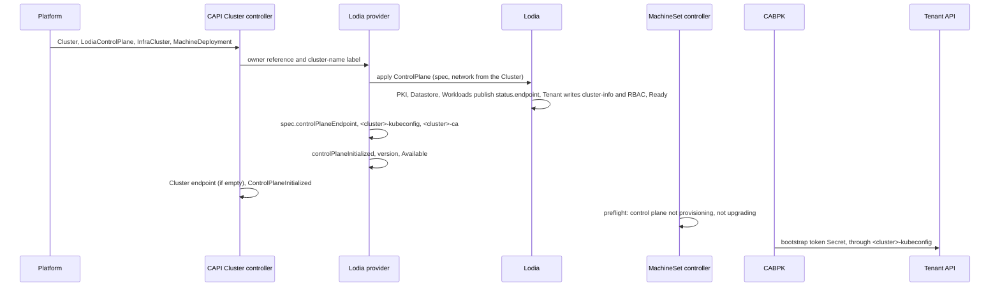

# cluster-api-provider-lodia — design

The first pass, 2026-10-26. Pinned sources: Cluster API [v1.14.3] (825a79d),
kubeadm and Kubernetes v1.35.0, and Lodia at [lodia-io/lodia@2c79579][lo]
(main, with the name cap of #22 and the API module of #23); links marked 5f212ed
point at the Lodia the design study read, before the rename from Brygga.

**In one paragraph.** `LodiaControlPlane` (`controlplane.lodia.io/v1alpha1`)
is a Cluster API control plane object that owns exactly one Lodia
`ControlPlane`, named after the `Cluster` and in its namespace. The provider
passes Lodia's spec through, takes the network from
`Cluster.spec.clusterNetwork`, and turns Lodia's status into the contract: the
endpoint, `controlPlaneInitialized`, the version, `Available`, and the two
Secrets Cluster API reads, `<cluster>-kubeconfig` and `<cluster>-ca`. It creates
no Machines, touches no InfraCluster and no `Cluster`. Workers join through
CAPI's kubeadm bootstrap provider (CABPK) with the bootstrap objects Lodia's
Tenant controller already writes ([nodes-join-with-kubeadm][lo-kubeadm]).

## 1. The contract, as built

Contract v1beta2 ([rules][cp-rules]). ✓ = built; — = not applicable, left out
or not built yet.

| | rule | the provider | source |
|---|---|---|---|
| ✓ | namespaced CRDs with `TypeMeta`/`ObjectMeta`; `LodiaControlPlane` and `LodiaControlPlaneList`; CRD name `lodiacontrolplanes.controlplane.lodia.io` | as stated | [scope][cp-scope], [definition][cp-crd], [CalculateCRDName][crd-name] |
| ✓ | contract label `cluster.x-k8s.io/v1beta2: v1alpha1` on both CRDs; without it CAPI cannot resolve the contract | a `+kubebuilder:metadata:labels` marker; a test checks both CRDs | [label][cp-label], [version.go][ct-label] |
| ✓ | a group other than `controlplane.cluster.x-k8s.io` grants CAPI core full access by an aggregated ClusterRole | `config/rbac/aggregated_role.yaml`, labelled `cluster.x-k8s.io/aggregate-to-manager: "true"` | [group][cp-group], [aggregated_role.yaml][rbac-agg] |
| ✓ | `spec.controlPlaneEndpoint`; the Cluster takes it together with initialization, and only while its own endpoint is empty | from `status.endpoint.apiServer`; never waits for the Cluster's endpoint | [endpoint][cp-endpoint], [cluster_controller_phases.go][cl-cp-endpoint] |
| ✓ | `spec.version`; the version in `status.versions` (preferred, new in v1.14) or `status.version` (read when `versions` is absent, dropped by the next contract version) | `status.version` from `status.kubernetes.version` | [version][cp-version], [CurrentStatusVersion][ct-current] |
| ✓ | `status.initialization.controlPlaneInitialized` | set the first time Lodia's `Ready` is True, and kept, as CAPI keeps the Cluster's ([Cluster controller][cl-cp]) | [initialization][cp-init] |
| ✓ | `status.externalManagedControlPlane` (written for managed control planes with Machines, but the Machine controller reads it before it drains and deletes any worker's Node; with no control plane Machines and the flag unset, a deleted worker is neither drained nor its Node deleted) | always `true` | [rule][cp-extmanaged], [isDeleteNodeAllowed][m-allowed], [util.go][util-extmanaged] |
| ✓ | conditions: `Available` is mirrored into the Cluster's `ControlPlaneAvailable` and must hold through disruption | `Available` mirrors Lodia's `Reachable`; `Ready` and `Paused` beside it (§2) | [conditions][cp-conditions], [mirror][cs-available] |
| ✓ | no terminal failure fields | none | [terminal failures][cp-failures] |
| ✓ | `LodiaControlPlaneTemplate` and its list, for ClusterClass | §2 | [template][cp-template] |
| ✓ | `<cluster>-kubeconfig` in the Cluster's namespace, type `cluster.x-k8s.io/secret`, label `cluster.x-k8s.io/cluster-name`, key `value`, short-lived client certificate renewed | Lodia's admin kubeconfig, copied | [kubeconfig][cp-kubeconfig], [consts.go][sec-consts] |
| ✓ | cluster certificates as `<cluster>-<purpose>` Secrets with the same type and label; CABPK reads `<cluster>-ca` for a worker's join | `<cluster>-ca` with `tls.crt` only (§4.3) | [certificates][cp-certs], [CABPK join][cabpk-worker] |
| ✓ | pause on `Cluster.spec.paused` or `cluster.x-k8s.io/paused`, surfaced as `Paused` | CAPI's `paused.EnsurePausedCondition`; Lodia keeps running | [pausing][cp-pause], [IsPaused][paused] |
| ✓ | clusterctl: `metadata.yaml` | `releaseSeries: [{major: 0, minor: 1, contract: v1beta2}]` | [metadata][cc-metadata] |
| — | clusterctl: `control-plane-components.yaml` | a release artifact, not built yet | [components][cc-components] |
| — | `--namespace` and `--watch-filter`, which the contract asks for only where several instances of a provider run | not built | [multiple instances][cp-multi] |
| — | `clusterctl move`: moving deletes the source objects | blocked (§5) | [move][cc-move], [block-move][move-ann] |
| — | `spec.replicas`, scale subresource, `status.selector` and the four counters ("mandatory if control plane has a notion of number of instances") | left out (§4.6) | [replicas][cp-replicas] |
| — | `machineTemplate`, rollout after, in-place updates, machine placement, metadata propagation, `minReadySeconds` | no Machines | [machines][cp-machines] |

No admission webhooks, as in Lodia ([CLAUDE.md][lo-claude]): the contract asks
for none, and every rule below is CEL.

## 2. The provider's API

### `LodiaControlPlane`

The pass-through fields reuse the nested types of `go.lodia.io/lodia/api`, so
their CEL comes along; the rules Lodia puts on `ControlPlaneSpec` and its fields
(required, immutable, set at creation only, the `Compact` exclusions) are
repeated, and `api/v1alpha1/crd_test.go` fails when the two schemas drift, as
Lodia's own [etcddruid_test.go][lo-etcddruid-test] does for etcd-druid's.

| `spec` field | → Lodia `ControlPlane` | rule |
|---|---|---|
| `version` | `spec.version` | required; Lodia's pattern `^v1\.[0-9]+\.[0-9]+$` and minor-never-decreases rule ([types][lo-version]); the topology controller writes it from `Cluster.spec.topology.version`, which CAPI only requires to start with `v` and be semver ([webhook][wh-topology-version]), so a pre-release or build suffix is refused here |
| `controlPlaneEndpoint` | ← `status.endpoint.apiServer.{host,port}` | written by the provider alone; the topology controller leaves it alone while empty ([IgnorePaths][ct-ignore]) |
| `layout`, `highAvailability`, `datastore`, `endpoint`, `apiServer`, `controllerManager`, `scheduler`, `addons`, `placement`, `maintenance`, `hibernation`, `health`, `serviceAccount`, `restoreFrom` | same field | Lodia's types and rules |
| — | `network.serviceCIDRs` ← `Cluster.spec.clusterNetwork.services.cidrBlocks` | optional on the Cluster ([ClusterNetwork][api-network]); Lodia requires one or two and never changes them ([types][lo-network]), so a Cluster without them, or a change to them, is refused by Lodia's API server and reported as `Refused` |
| — | `network.podCIDRs` ← `…pods.cidrBlocks` | the same |
| — | `network.clusterDomain` ← `…serviceDomain` | Lodia's default `cluster.local` when unset |
| — | `paused` | never written: Lodia's own pause stays a break-glass switch on the `ControlPlane` ([paused][lo-paused]) |
| (`Cluster.spec.clusterNetwork.apiServerPort`) | — | ignored: the port is the endpoint mode's ([api-exposure][lo-exposure]) |

The spec reaches the `ControlPlane` by its JSON field names: the provider
converts the `LodiaControlPlane`'s spec, drops `controlPlaneEndpoint` and adds
the network, so a field the CRD test makes the two schemas share needs no code.

| `status` field | from Lodia | note |
|---|---|---|
| `initialization.controlPlaneInitialized` | `Ready` True | set once, never cleared |
| `externalManagedControlPlane` | — | always `true` |
| `version` | `status.kubernetes.version` | set once Lodia reports one (§4.1) |

| condition | written as |
|---|---|
| `Available` | a mirror of Lodia's `Reachable`: status, reason, message; `Unknown`, `NotYetReported` while the `ControlPlane` has none |
| `Ready` | a mirror of Lodia's `Ready`, unless the provider cannot write: `Refused` (the API server refuses the `ControlPlane` or a Secret; the message is the server's), `ObjectsControlledElsewhere` (the `ControlPlane`, `<cluster>-kubeconfig` or `<cluster>-ca` exists with another controller, or none, which the message names), `Deleting` (waiting for the `ControlPlane` to go) |
| `Paused` | CAPI's pause |

A refused or blocked write, like any other failed one, ends the pass with its
error, and the pass is retried with backoff.

### `LodiaControlPlaneTemplate`

`spec.template.{metadata, spec}`, where `spec` holds the pass-through fields
without `version`, `controlPlaneEndpoint` and `restoreFrom`, with the same
rules; per-cluster values such as `endpoint.gateway.hostnames` come from
ClusterClass variables and patches.

### What the provider writes

| object | name | owner | label | content |
|---|---|---|---|---|
| Lodia `ControlPlane` | the Cluster's | controller reference to the `LodiaControlPlane`, `blockOwnerDeletion` | `cluster.x-k8s.io/cluster-name` | the spec above |
| Secret `<cluster>-kubeconfig` | | the same | the same | `value` = key `kubeconfig` of `<cp>-admin-kubeconfig` ([names.go][lo-names-kubeconfig]) |
| Secret `<cluster>-ca` | | the same | the same | `tls.crt` = key `ca.crt` of `<cp>-ca-bundle` ([names.go][lo-names-ca]); no `tls.key` (§4.3) |
| annotation `clusterctl.cluster.x-k8s.io/block-move` | on the `LodiaControlPlane` | | | `"true"`, written before the `ControlPlane` is created (§5) |

All three objects are applied server-side as `cluster-api-provider-lodia`, both
Secrets with `type: cluster.x-k8s.io/secret` ([common_types.go][api-consts]).
Before each apply the provider reads the object from the API server, past the
cache: when it exists with another controller, or none, the provider leaves it
alone and reports `ObjectsControlledElsewhere`, so it never adopts a
predecessor's object. The `ControlPlane` sits in the Cluster's namespace
because owner references never cross namespaces ([owners][k8s-owners]); it is
named after the Cluster, not after the `LodiaControlPlane`, because a Cluster
has one `controlPlaneRef`, ClusterClass names that object `<cluster>-<random>`,
and the name stays when the object is replaced.

The cache holds no Secret data. The provider watches the metadata of Secrets
labelled `lodia.io/control-plane` ([labels][lo-labels]), maps
`<cp>-admin-kubeconfig` and `<cp>-ca-bundle` to the `LodiaControlPlane` of the
Cluster of that name, and reads both, and its own two, from the API server on
every pass. `ControlPlane` and `Cluster` events map the same way, through the
Cluster's `controlPlaneRef`, so a leftover `ControlPlane` of another owner
wakes the provider when it goes. A pass has a minute ([ReconciliationTimeout][cr-timeout]).

RBAC, generated from markers into `config/rbac/role.yaml`:
`lodiacontrolplanes` get/list/watch/patch/update, `/status` patch/update,
`/finalizers` update; `lodia.io` `controlplanes` get/list/watch/create/patch/delete;
`cluster.x-k8s.io` `clusters` get/list/watch; `secrets`
get/list/watch/create/patch. The envtest suite runs the controller as a user
bound to that role. Module `go.lodia.io/cluster-api-provider-lodia`,
importing `sigs.k8s.io/cluster-api/api` (its own module since v1.14) and
`go.lodia.io/lodia/api` ([go.mod][lo-api-gomod]).

### A pass

1. Wait for the owner reference the Cluster controller writes
   ([ensureOwnerRefAndLabel][cl-ownerref]), as both reference providers do.
2. Add the finalizer `controlplane.lodia.io/lodiacontrolplane`
   ([EnsureFinalizer][finalizers]); then pause ([EnsurePausedCondition][paused-cond]).
3. Write the block-move annotation and end the pass, so it is stored before
   anything exists to move.
4. Apply the `ControlPlane`, then the two Secrets from Lodia's, each when its
   source exists; then copy the status. The `LodiaControlPlane` is patched once,
   at the end ([patch][patch]).

Deletion: CAPI deletes workers first, then the control plane object, and waits
for it ([deletion order][cl-delete]). The provider deletes the `ControlPlane`
and keeps its finalizer until a read past the cache finds the `ControlPlane`
gone, which Lodia's `lodia.io/datastore` finalizer decides once the etcd is
released (a paused `ControlPlane` waits for unpause); the Secrets go with
their owner. A `ControlPlane` of another controller is left alone.

## 3. The flow

1. Lodia builds the `ControlPlane`: Workloads publishes `status.endpoint`, PKI
   writes the admin kubeconfig against it ([pki/secrets.go][lo-admin]) and the
   CA bundle, Tenant writes `cluster-info`, `kubeadm-config`, `kubelet-config`
   and the RBAC for the group `system:bootstrappers:kubeadm:default-node-token`
   ([bootstrap.yaml][lo-bootstrap-rbac]), Lifecycle sets `Ready`
   ([README][lo-readme-lifecycle]).
2. The provider does not wait for `Cluster.spec.controlPlaneEndpoint`: CAPI
   copies the control plane's endpoint only once the control plane reports
   initialized, and only while the Cluster's is empty
   ([cluster_controller_phases.go][cl-cp-endpoint]). A Cluster without
   `infrastructureRef` counts as provisioned ([no infra][cl-noinfra]); with an
   InfraCluster, that one must leave the endpoint empty.
3. CAPI sets `ControlPlaneInitialized` on the Cluster ([status][cs-init]); its
   ClusterCache connects with `<cluster>-kubeconfig` once the infrastructure is
   provisioned, and refuses exec or auth-provider credentials
   ([cluster_cache.go][cache-infra], [REST config][cache-rest]); Lodia's admin
   kubeconfig carries client certificates.
4. The MachineSet controller creates Machines only while the control plane is
   neither provisioning (no reported version) nor upgrading (`spec.version` above
   it), and, with `KubeadmConfigTemplate`, only for the control plane's minor
   ([preflight][ms-preflight], [kubeadm skew][ms-kubeadm], gate on by default:
   [feature.go][feature], [contract state][ct-state]).
5. CABPK waits for `ControlPlaneInitialized` ([gate][cabpk-gate]), reads
   `<cluster>-ca`, pins every certificate in `tls.crt`, takes
   `apiServerEndpoint` from the Cluster, and creates a bootstrap token in the
   tenant through the ClusterCache ([joinWorker][cabpk-worker],
   [reconcileDiscovery][cabpk-discovery], [token.go][cabpk-token]); kubeadm
   join reads `cluster-info`, waits for its JWS signature from Lodia's
   bootstrap signer, checks any CA against the pins and bootstraps against the
   server `cluster-info` names ([discovery][kubeadm-discovery],
   [pins][kubeadm-pins], [JWS wait][kubeadm-jws]).

**Upgrade.** A new `spec.version` reaches Lodia, which steps one minor at a time;
`status.version` moves when Lodia's version does, so CAPI holds new workers as
"upgrading" until then and then lets the MachineDeployment follow.

## 4. What Lodia's API needed, and where it stands

| # | Cluster API needs | Lodia now | where |
|---|---|---|---|
| 4.1 | a control plane version in status | `status.kubernetes.version` defined, written from phase 2 | Lodia |
| 4.2 | an `Available` that survives node outages | done in #22: `Reachable` is about the API; the controller manager hold is `ControllerManagerHeld`, outside `Ready` ([conditions][lo-ref-conditions]) | — |
| 4.3 | `<cluster>-ca` with `tls.crt`, and for CABPK ≤ v1.14.3 a non-empty `tls.key` | `<cp>-ca-bundle` (`ca.crt`); the key is PKI's alone by design | decided: wait for CAPI v1.15 |
| 4.4 | names a CAPI `Cluster` can have | done in #22: a DNS-1035 label of at most 32 characters, CEL ([types][lo-name-cap], [field reference][lo-ref-name]) | — |
| 4.5 | types a provider can import | done in #23: `go.lodia.io/lodia/api`, with the CRDs as `crds.FS`; it requires `k8s.io/api` v0.37, which has no `scheduling/v1alpha2`, while the `client-go` v0.36 that Cluster API v1.14.3 builds on imports it ([go.mod][lo-api-gomod]) | Lodia: require the lowest `k8s.io` its types need |
| 4.6 | replica counts, only with `spec.replicas` | none | not now |
| — | endpoint, kubeconfig, initialized, network | `status.endpoint.apiServer`, `<cp>-admin-kubeconfig`, `Ready`, `spec.network` | none needed |

### 4.1 A version in status

With no `status.versions` and no `status.version`, the contract reads the
control plane as provisioning; with `spec.version` above the reported one, as
upgrading ([contract state][ct-state]). Either holds every new Machine in the
MachineSet preflight `ControlPlaneIsStable`, which runs by default
([preflight][ms-preflight], [feature.go][feature]), and the topology controller
uses the same checks for ClusterClass upgrades. Without a version, no worker is
ever created. Lodia's `status.kubernetes.version`, "the version every component
runs" ([field reference][lo-ref-kubernetes]), is what the provider copies, and
Lodia writes it from phase 2.

### 4.3 The CA Secret

CABPK looks up `<cluster>-ca` for a worker as a set holding the cluster CA
alone, then requires the cert and a non-empty key for every certificate not
marked external, and the worker's is not ([NewCertificatesForWorker][sec-worker],
[EnsureAllExist][sec-ensure], [joinWorker][cabpk-worker]); a Secret with
`tls.crt` alone fails with `missing key data`. The worker path never uses the
key: it hashes the certificates in `tls.crt` ([Hashes][sec-hashes],
[discovery][cabpk-discovery]). Upstream: issue [#14388][capi-14388] and PR
[#14389][capi-14389] require the key only where a key file is written; the PR
targets `main`, which becomes v1.15.

Lodia's `<cp>-ca-bundle` has the cluster CA under `ca.crt`, two during a trust
anchor rotation; the key lives in `<cp>-cakey-cluster`, PKI's alone, never
mounted ([README][lo-readme-secrets]). The provider copies `ca.crt` into
`tls.crt`; during a rotation both CAs travel, CABPK pins both and kubeadm
accepts any ([pins][kubeadm-pins]). It never copies the key: CABPK's cache
keeps the data of every labelled `-ca` Secret ([CABPK cache][cabpk-cache]), and
the trust anchor's key would sit in another controller's memory and in a Secret
every reader of the namespace's Secrets can read. Decided: no placeholder
`tls.key`; workers join once a CAPI release carries #14389.

### 4.6 Replica counts: not now

They belong to the contract only together with `spec.replicas`, the scale
subresource, `status.selector`, the four counters and a replica count per
version entry ([replicas][cp-replicas], [version][cp-version]). Lodia's
availability is a failure tolerance (`highAvailability`) with replica counts
derived from it, not one number of instances, so the provider leaves `replicas`
out; CAPI then leaves the Cluster's control plane counters empty
([setControlPlaneReplicas][cs-replicas]).

## 5. Risks and open questions

**Risks**

1. *`clusterctl move`* re-creates the objects elsewhere and deletes the source
   ones ([deleteSourceObject][move-delete]); the `ControlPlane` would follow its
   owner into garbage collection. Every `LodiaControlPlane` carries
   `clusterctl.cluster.x-k8s.io/block-move`, which makes move wait and fail
   before it creates anything ([annotation][move-ann], [wait][move-wait]): a
   hosted control plane does not move.
2. *The endpoint is copied once* ([Cluster controller][cl-cp-endpoint]): a
   LoadBalancer Service recreated with a new address, or in node port mode the
   loss of the node the endpoint names ([field reference][lo-ref-nodeport]),
   leaves the Cluster, and every later join, on the old address.
3. *MachineHealthCheck against the controller manager hold.* When nodes are cut
   off from the control plane, Lodia holds the controller manager so nothing
   evicts their pods ([README][lo-readme-health]); an MHC sees the same nodes
   NotReady and replaces the Machines. Recommend
   `remediation.triggerIf.unhealthyLessThanOrEqualTo` below Lodia's hold
   fraction, 0.6 ([MHC][mhc], [configuration][lo-readme-config]).
4. *Hibernation (Lodia's phase 3).* The API is down by design: the ClusterCache
   probe fails, the Cluster reports unavailable, and an MHC replaces every node.
5. *The management cluster reaches the tenant through the public endpoint*,
   the address in `<cluster>-kubeconfig`: gateway mode needs in-cluster DNS and
   a hairpin through the Gateway, and a NetworkPolicy on the API server has to
   admit CAPI's controllers from inside the management cluster
   ([README][lo-readme-netpol]).
6. *One credential for two uses.* CAPI's kubeconfig "MUST not be shared with
   other users or applications" ([kubeconfig][cp-kubeconfig]); Lodia's admin
   kubeconfig is also the platform's automation credential
   ([short-lived-kubeconfigs][lo-shortlived]), so revoking one revokes both.
7. *Stricter skew for CAPI workers.* The kubeadm preflight creates workers only
   on the control plane's minor ([kubeadm skew][ms-kubeadm]), while Lodia lets
   nodes lag three minors; existing workers keep running.
8. *Contract window.* v1beta2 since CAPI v1.11; `status.versions` is read from
   v1.14 and `status.version` goes with the next contract version
   ([version][cp-version]); the v1beta1 contract is on track to go in v1.16
   ([v1.14 notes][mig-removals]); Lodia's minors 1.35–1.37 are all supported by
   v1.14, 1.37 from v1.14.1 ([support matrix][capi-versions]).

**Open questions**

1. InfraClusters: who marks a `KubevirtCluster` provisioned for Segla's KubeVirt
   pools: Segla's `cluster` service, or an opt-in in the provider, as both
   reference providers do ([Kamaji][kp-patchcluster], [k0smotron][k0-infra])?
2. A dedicated CAPI identity (risk 6): a second standing kubeconfig from PKI, or
   accept the shared one.
3. Hibernation and MHC (risks 3, 4): document, or have the provider surface the
   state to CAPI, which has no contract for pausing remediation.
4. The cut-over from Kamaji ([roadmap][lo-roadmap-cutover]) is more than a
   `controlPlaneRef` swap, which CAPI allows ([webhook][wh-cpref]): the Cluster
   keeps its endpoint; the old object owns `<cluster>-kubeconfig` and
   `<cluster>-ca` ([Kamaji][kp-ca]), which this provider then reports as
   `ObjectsControlledElsewhere` until they go; and Lodia's cluster CA is not the
   one the nodes trust.

<!-- Cluster API v1.14.3 -->
[v1.14.3]: https://github.com/kubernetes-sigs/cluster-api/tree/v1.14.3
[cp-rules]: https://github.com/kubernetes-sigs/cluster-api/blob/v1.14.3/docs/book/src/developer/providers/contracts/control-plane.md?plain=1#L58-L83
[cp-scope]: https://github.com/kubernetes-sigs/cluster-api/blob/v1.14.3/docs/book/src/developer/providers/contracts/control-plane.md?plain=1#L85-L91
[cp-group]: https://github.com/kubernetes-sigs/cluster-api/blob/v1.14.3/docs/book/src/developer/providers/contracts/control-plane.md?plain=1#L98-L144
[cp-label]: https://github.com/kubernetes-sigs/cluster-api/blob/v1.14.3/docs/book/src/developer/providers/contracts/control-plane.md?plain=1#L146-L184
[cp-crd]: https://github.com/kubernetes-sigs/cluster-api/blob/v1.14.3/docs/book/src/developer/providers/contracts/control-plane.md?plain=1#L186-L235
[cp-endpoint]: https://github.com/kubernetes-sigs/cluster-api/blob/v1.14.3/docs/book/src/developer/providers/contracts/control-plane.md?plain=1#L237-L279
[cp-replicas]: https://github.com/kubernetes-sigs/cluster-api/blob/v1.14.3/docs/book/src/developer/providers/contracts/control-plane.md?plain=1#L309-L387
[cp-version]: https://github.com/kubernetes-sigs/cluster-api/blob/v1.14.3/docs/book/src/developer/providers/contracts/control-plane.md?plain=1#L389-L457
[cp-machines]: https://github.com/kubernetes-sigs/cluster-api/blob/v1.14.3/docs/book/src/developer/providers/contracts/control-plane.md?plain=1#L459-L656
[cp-extmanaged]: https://github.com/kubernetes-sigs/cluster-api/blob/v1.14.3/docs/book/src/developer/providers/contracts/control-plane.md?plain=1#L606-L622
[cp-init]: https://github.com/kubernetes-sigs/cluster-api/blob/v1.14.3/docs/book/src/developer/providers/contracts/control-plane.md?plain=1#L658-L711
[cp-conditions]: https://github.com/kubernetes-sigs/cluster-api/blob/v1.14.3/docs/book/src/developer/providers/contracts/control-plane.md?plain=1#L740-L787
[cp-failures]: https://github.com/kubernetes-sigs/cluster-api/blob/v1.14.3/docs/book/src/developer/providers/contracts/control-plane.md?plain=1#L789-L817
[cp-template]: https://github.com/kubernetes-sigs/cluster-api/blob/v1.14.3/docs/book/src/developer/providers/contracts/control-plane.md?plain=1#L819-L865
[cp-kubeconfig]: https://github.com/kubernetes-sigs/cluster-api/blob/v1.14.3/docs/book/src/developer/providers/contracts/control-plane.md?plain=1#L867-L886
[cp-certs]: https://github.com/kubernetes-sigs/cluster-api/blob/v1.14.3/docs/book/src/developer/providers/contracts/control-plane.md?plain=1#L888-L899
[cp-multi]: https://github.com/kubernetes-sigs/cluster-api/blob/v1.14.3/docs/book/src/developer/providers/contracts/control-plane.md?plain=1#L949-L961
[cp-pause]: https://github.com/kubernetes-sigs/cluster-api/blob/v1.14.3/docs/book/src/developer/providers/contracts/control-plane.md?plain=1#L967-L971
[cc-metadata]: https://github.com/kubernetes-sigs/cluster-api/blob/v1.14.3/docs/book/src/developer/providers/contracts/clusterctl.md?plain=1#L188-L235
[cc-components]: https://github.com/kubernetes-sigs/cluster-api/blob/v1.14.3/docs/book/src/developer/providers/contracts/clusterctl.md?plain=1#L237-L286
[cc-move]: https://github.com/kubernetes-sigs/cluster-api/blob/v1.14.3/docs/book/src/developer/providers/contracts/clusterctl.md?plain=1#L521-L587
[mig-removals]: https://github.com/kubernetes-sigs/cluster-api/blob/v1.14.3/docs/book/src/developer/providers/migrations/v1.13-to-v1.14.md?plain=1#L136-L137
[capi-versions]: https://github.com/kubernetes-sigs/cluster-api/blob/v1.14.3/docs/book/src/reference/versions.md?plain=1#L365-L375
[cl-ownerref]: https://github.com/kubernetes-sigs/cluster-api/blob/v1.14.3/core/reconcilers/cluster/cluster_controller_phases.go#L99-L138
[cl-noinfra]: https://github.com/kubernetes-sigs/cluster-api/blob/v1.14.3/core/reconcilers/cluster/cluster_controller_phases.go#L145-L153
[cl-cp]: https://github.com/kubernetes-sigs/cluster-api/blob/v1.14.3/core/reconcilers/cluster/cluster_controller_phases.go#L251-L350
[cl-cp-endpoint]: https://github.com/kubernetes-sigs/cluster-api/blob/v1.14.3/core/reconcilers/cluster/cluster_controller_phases.go#L324-L341
[cs-replicas]: https://github.com/kubernetes-sigs/cluster-api/blob/v1.14.3/core/reconcilers/cluster/cluster_controller_status.go#L121-L175
[cs-available]: https://github.com/kubernetes-sigs/cluster-api/blob/v1.14.3/core/reconcilers/cluster/cluster_controller_status.go#L450-L494
[cs-init]: https://github.com/kubernetes-sigs/cluster-api/blob/v1.14.3/core/reconcilers/cluster/cluster_controller_status.go#L551-L627
[cl-delete]: https://github.com/kubernetes-sigs/cluster-api/blob/v1.14.3/core/reconcilers/cluster/cluster_controller.go#L403-L457
[ct-ignore]: https://github.com/kubernetes-sigs/cluster-api/blob/v1.14.3/internal/contract/controlplane.go#L130-L155
[ct-state]: https://github.com/kubernetes-sigs/cluster-api/blob/v1.14.3/internal/contract/controlplane.go#L275-L372
[ct-current]: https://github.com/kubernetes-sigs/cluster-api/blob/v1.14.3/internal/contract/controlplane.go#L355-L372
[ct-label]: https://github.com/kubernetes-sigs/cluster-api/blob/v1.14.3/internal/contract/version.go#L118-L143
[crd-name]: https://github.com/kubernetes-sigs/cluster-api/blob/v1.14.3/util/contract/contract.go#L28-L30
[sec-consts]: https://github.com/kubernetes-sigs/cluster-api/blob/v1.14.3/util/secret/consts.go#L21-L53
[sec-worker]: https://github.com/kubernetes-sigs/cluster-api/blob/v1.14.3/util/secret/certificates.go#L188-L200
[sec-ensure]: https://github.com/kubernetes-sigs/cluster-api/blob/v1.14.3/util/secret/certificates.go#L271-L287
[sec-hashes]: https://github.com/kubernetes-sigs/cluster-api/blob/v1.14.3/util/secret/certificates.go#L352-L369
[cabpk-cache]: https://github.com/kubernetes-sigs/cluster-api/blob/v1.14.3/bootstrap/kubeadm/setup/setup.go#L47-L69
[cache-infra]: https://github.com/kubernetes-sigs/cluster-api/blob/v1.14.3/controllers/clustercache/cluster_cache.go#L483-L488
[cache-rest]: https://github.com/kubernetes-sigs/cluster-api/blob/v1.14.3/controllers/clustercache/cluster_accessor_client.go#L124-L150
[cabpk-gate]: https://github.com/kubernetes-sigs/cluster-api/blob/v1.14.3/bootstrap/kubeadm/reconcilers/kubeadmconfig/kubeadmconfig_controller.go#L351-L368
[cabpk-worker]: https://github.com/kubernetes-sigs/cluster-api/blob/v1.14.3/bootstrap/kubeadm/reconcilers/kubeadmconfig/kubeadmconfig_controller.go#L650-L692
[cabpk-discovery]: https://github.com/kubernetes-sigs/cluster-api/blob/v1.14.3/bootstrap/kubeadm/reconcilers/kubeadmconfig/kubeadmconfig_controller.go#L1271-L1331
[cabpk-token]: https://github.com/kubernetes-sigs/cluster-api/blob/v1.14.3/bootstrap/kubeadm/reconcilers/kubeadmconfig/token.go#L32-L68
[m-allowed]: https://github.com/kubernetes-sigs/cluster-api/blob/v1.14.3/core/reconcilers/machine/machine_controller.go#L806-L856
[util-extmanaged]: https://github.com/kubernetes-sigs/cluster-api/blob/v1.14.3/util/util.go#L102-L110
[ms-preflight]: https://github.com/kubernetes-sigs/cluster-api/blob/v1.14.3/core/reconcilers/machineset/machineset_preflight.go#L48-L193
[ms-kubeadm]: https://github.com/kubernetes-sigs/cluster-api/blob/v1.14.3/core/reconcilers/machineset/machineset_preflight.go#L211-L229
[feature]: https://github.com/kubernetes-sigs/cluster-api/blob/v1.14.3/feature/feature.go#L104
[api-network]: https://github.com/kubernetes-sigs/cluster-api/blob/v1.14.3/api/core/v1beta2/cluster_types.go#L1381-L1417
[api-consts]: https://github.com/kubernetes-sigs/cluster-api/blob/v1.14.3/api/core/v1beta2/common_types.go#L156-L170
[mhc]: https://github.com/kubernetes-sigs/cluster-api/blob/v1.14.3/api/core/v1beta2/machinehealthcheck_types.go#L144-L166
[wh-topology-version]: https://github.com/kubernetes-sigs/cluster-api/blob/v1.14.3/core/webhooks/admission/cluster.go#L265-L285
[wh-cpref]: https://github.com/kubernetes-sigs/cluster-api/blob/v1.14.3/core/webhooks/admission/cluster.go#L194-L202
[move-ann]: https://github.com/kubernetes-sigs/cluster-api/blob/v1.14.3/cmd/clusterctl/api/v1alpha3/annotations.go#L35-L43
[move-wait]: https://github.com/kubernetes-sigs/cluster-api/blob/v1.14.3/cmd/clusterctl/client/cluster/mover.go#L685-L735
[move-delete]: https://github.com/kubernetes-sigs/cluster-api/blob/v1.14.3/cmd/clusterctl/client/cluster/mover.go#L1260-L1312
[paused]: https://github.com/kubernetes-sigs/cluster-api/blob/v1.14.3/util/annotations/helpers.go#L31-L36
[paused-cond]: https://github.com/kubernetes-sigs/cluster-api/blob/v1.14.3/util/paused/paused.go#L44-L91
[finalizers]: https://github.com/kubernetes-sigs/cluster-api/blob/v1.14.3/util/finalizers/finalizers.go#L27-L49
[patch]: https://github.com/kubernetes-sigs/cluster-api/blob/v1.14.3/util/patch/patch.go#L82-L83
[rbac-agg]: https://github.com/kubernetes-sigs/cluster-api/blob/v1.14.3/core/config/rbac/aggregated_role.yaml#L8
[capi-14388]: https://github.com/kubernetes-sigs/cluster-api/issues/14388
[capi-14389]: https://github.com/kubernetes-sigs/cluster-api/pull/14389

<!-- controller-runtime, kubeadm, Kubernetes -->
[cr-timeout]: https://github.com/kubernetes-sigs/controller-runtime/blob/v0.24.1/pkg/config/controller.go#L89-L91
[kubeadm-discovery]: https://github.com/kubernetes/kubernetes/blob/v1.35.0/cmd/kubeadm/app/discovery/token/token.go#L59-L152
[kubeadm-pins]: https://github.com/kubernetes/kubernetes/blob/v1.35.0/cmd/kubeadm/app/discovery/token/token.go#L191-L209
[kubeadm-jws]: https://github.com/kubernetes/kubernetes/blob/v1.35.0/cmd/kubeadm/app/discovery/token/token.go#L211-L259
[k8s-owners]: https://kubernetes.io/docs/concepts/overview/working-with-objects/owners-dependents/

<!-- the reference providers -->
[kp-patchcluster]: https://github.com/clastix/cluster-api-control-plane-provider-kamaji/blob/v0.21.0/controllers/kamajicontrolplane_controller_cluster_patch.go#L104-L151
[kp-ca]: https://github.com/clastix/cluster-api-control-plane-provider-kamaji/blob/v0.21.0/controllers/kamajicontrolplane_controller_resources.go#L61-L124
[k0-infra]: https://github.com/k0sproject/k0smotron/blob/v2.3.0/internal/controller/controlplane/k0smotron_controlplane_controller.go#L888-L959

<!-- Lodia at 2c79579 -->
[lo]: https://github.com/lodia-io/lodia/tree/2c795797cbc2cb1a45ebcb033bed5fa4ae86ef3c
[lo-name-cap]: https://github.com/lodia-io/lodia/blob/2c795797cbc2cb1a45ebcb033bed5fa4ae86ef3c/api/v1alpha1/controlplane_types.go#L17
[lo-ref-name]: https://github.com/lodia-io/lodia/blob/2c795797cbc2cb1a45ebcb033bed5fa4ae86ef3c/docs/api/controlplane.md?plain=1#L7-L16
[lo-ref-conditions]: https://github.com/lodia-io/lodia/blob/2c795797cbc2cb1a45ebcb033bed5fa4ae86ef3c/docs/api/controlplane.md?plain=1#L121-L122
[lo-ref-kubernetes]: https://github.com/lodia-io/lodia/blob/2c795797cbc2cb1a45ebcb033bed5fa4ae86ef3c/docs/api/controlplane.md?plain=1#L79
[lo-api-gomod]: https://github.com/lodia-io/lodia/blob/2c795797cbc2cb1a45ebcb033bed5fa4ae86ef3c/api/go.mod#L1-L10
[lo-version]: https://github.com/lodia-io/lodia/blob/2c795797cbc2cb1a45ebcb033bed5fa4ae86ef3c/api/v1alpha1/controlplane_types.go#L49-L55
[lo-network]: https://github.com/lodia-io/lodia/blob/2c795797cbc2cb1a45ebcb033bed5fa4ae86ef3c/api/v1alpha1/controlplane_types.go#L272-L293
[lo-paused]: https://github.com/lodia-io/lodia/blob/2c795797cbc2cb1a45ebcb033bed5fa4ae86ef3c/api/v1alpha1/controlplane_types.go#L124-L126
[lo-names-ca]: https://github.com/lodia-io/lodia/blob/2c795797cbc2cb1a45ebcb033bed5fa4ae86ef3c/api/v1alpha1/names.go#L21-L29
[lo-names-kubeconfig]: https://github.com/lodia-io/lodia/blob/2c795797cbc2cb1a45ebcb033bed5fa4ae86ef3c/api/v1alpha1/names.go#L45-L57
[lo-labels]: https://github.com/lodia-io/lodia/blob/2c795797cbc2cb1a45ebcb033bed5fa4ae86ef3c/api/v1alpha1/labels.go#L17-L20

<!-- Lodia at 5f212ed, as the design study read it -->
[lo-claude]: https://github.com/lodia-io/lodia/blob/5f212ed9acd71fe2a944e5fe63cad73e3d17812e/CLAUDE.md?plain=1#L53-L54
[lo-etcddruid-test]: https://github.com/lodia-io/lodia/blob/5f212ed9acd71fe2a944e5fe63cad73e3d17812e/api/v1alpha1/etcddruid_test.go
[lo-readme-secrets]: https://github.com/lodia-io/lodia/blob/5f212ed9acd71fe2a944e5fe63cad73e3d17812e/docs/README.md?plain=1#L151-L163
[lo-readme-netpol]: https://github.com/lodia-io/lodia/blob/5f212ed9acd71fe2a944e5fe63cad73e3d17812e/docs/README.md?plain=1#L510-L518
[lo-readme-lifecycle]: https://github.com/lodia-io/lodia/blob/5f212ed9acd71fe2a944e5fe63cad73e3d17812e/docs/README.md?plain=1#L634-L646
[lo-readme-health]: https://github.com/lodia-io/lodia/blob/5f212ed9acd71fe2a944e5fe63cad73e3d17812e/docs/README.md?plain=1#L761-L773
[lo-readme-config]: https://github.com/lodia-io/lodia/blob/5f212ed9acd71fe2a944e5fe63cad73e3d17812e/docs/README.md?plain=1#L885-L886
[lo-kubeadm]: https://github.com/lodia-io/lodia/blob/5f212ed9acd71fe2a944e5fe63cad73e3d17812e/docs/decisions/nodes-join-with-kubeadm.md?plain=1#L34-L35
[lo-shortlived]: https://github.com/lodia-io/lodia/blob/5f212ed9acd71fe2a944e5fe63cad73e3d17812e/docs/decisions/short-lived-kubeconfigs.md?plain=1#L22-L29
[lo-exposure]: https://github.com/lodia-io/lodia/blob/5f212ed9acd71fe2a944e5fe63cad73e3d17812e/docs/decisions/api-exposure.md?plain=1#L12-L14
[lo-roadmap-cutover]: https://github.com/lodia-io/lodia/blob/5f212ed9acd71fe2a944e5fe63cad73e3d17812e/docs/roadmap.md?plain=1#L16-L24
[lo-admin]: https://github.com/lodia-io/lodia/blob/5f212ed9acd71fe2a944e5fe63cad73e3d17812e/internal/controller/pki/secrets.go#L322-L323
[lo-bootstrap-rbac]: https://github.com/lodia-io/lodia/blob/5f212ed9acd71fe2a944e5fe63cad73e3d17812e/internal/controller/tenant/manifests/bootstrap.yaml#L36-L47
[lo-ref-nodeport]: https://github.com/lodia-io/lodia/blob/5f212ed9acd71fe2a944e5fe63cad73e3d17812e/docs/api/controlplane.md?plain=1#L23
